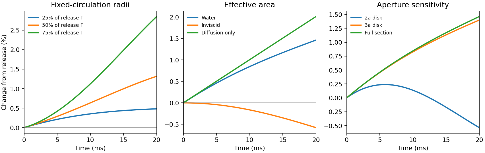

# The isolated ring spreads overall. The corrected water step still misses the force target.

Over 20 ms, the unforced isolated ring flattened while the area occupied by its circulation **grew**. A small disk following the strongest vorticity lost some of the circulation it was supposed to measure. Accounting for that transport resolves the apparent conflict in R290. In the separate compressible disk test, an independently confirmed error in the liquid-water flux Jacobian was corrected. At 12 ns the pressure response closely followed the explicit simulation. Radial acceleration and local vorticity-rate accuracy still failed. **Decision B** is to establish a balanced compressible disk release and working slow-time method first. [Measurements defined before reanalysis](r291/PROTOCOL.md) · [Evidence and reproduction](r291/REPLAY.md)

## How much space does the circulation occupy?

In a plane normal to the ring, let w be the oriented vorticity through the plane. Integrating w gives circulation, and integrating w² measures cross-sectional enstrophy (here without the conventional factor of one-half). For a single signed core, the effective area A = (∫w dA)² / ∫w² dA measures how broadly that circulation is distributed. Uniform vorticity over a patch returns its actual area. A narrow, intense core carrying the same circulation has smaller effective area. Separately measure circles enclosing fixed fractions of the **full release circulation** and the two principal widths of the vorticity distribution. Dividing by the instantaneous circulation inside a small disk would silently change the amount being tracked.

| Whole-section or ridge-centered measure | Release → 20 ms, viscous | Viscous change | Inviscid control | Pure diffusion |
|---|---:|---:|---:|---:|
| Effective area, mm² | 25.190 → 25.558 | +1.463% | −0.578% | +2.012% |
| Principal-width ellipse area, mm² | 12.595 → 12.970 | +2.975% | +0.965% | +2.012% |
| Minor width, mm | 2.000 → 1.941 | −2.942% | −3.936% | +0.998% |
| Major width, mm | 2.005 → 2.127 | +6.096% | +5.102% | +1.003% |
| Radius enclosing 25%, mm | 1.074 → 1.079 | +0.483% | −0.541% | +1.001% |
| Radius enclosing 50%, mm | 1.667 → 1.689 | +1.317% | +0.321% | +1.001% |
| Radius enclosing 75%, mm | 2.357 → 2.425 | +2.849% | +1.901% | +1.001% |

The inviscid control tightened around the inner quarter of its circulation while its outer three quarters spread. The viscous ring spread 0.549 percentage points less in effective area than heat flow alone. Restoring viscosity to the advecting ring increased that area change by 2.041 points. Total circulation stayed within 10⁻¹¹ of release in relative terms. [Control histories and uncertainty](r291/ring_summary.json)

**The measurement boundary explains the earlier negative area.** At aperture radii 1.8a, 2a, 2.2a, 3a, and 4a the measured effective area changed by −1.410%, −0.536%, +0.231%, +1.399%, and +1.462%. Here a = 2 mm. The 4a and 5a results agree with the full section to 0.00022 percentage points. On the moving 2a disk the signed outward circulation contributions from fluid advection, viscosity, and rim motion were −42.91, +5.62 and +73.62 × 10⁻⁶ m²/s. They explain the measured loss of 36.34 × 10⁻⁶ m²/s, with a maximum history discrepancy of 0.009 × 10⁻⁶ m²/s. The geometric-line material segment shortened 0.598% and lost 2.489% of its intensity. A forward marker lengthened 2.914% and gained 1.151% in intensity even while the section spread. Ridge migration and material stretching are separately measurable. [R290 transport and material budgets](ring-evolution/analysis.json) · [Aperture and center series](r291/sections/n16_L80_s4.csv)

The effective and ellipse area uncertainty envelopes at 20 ms are ±0.00030 and ±0.00170 percentage points. Both clear the quarter-signal criterion at the last three outputs under independent grid, step, box, shift and tail checks. [Measurement convergence](r291/REPLAY.md#measurement-details)

Center choice dominates the radius estimates. Switching from the ridge to the centroid gives +1.641%, +1.312% and +1.240% for the three radii. With the carried center the values are +0.947%, +0.860% and +1.386%. Every tested center gives outward movement at 20 ms. The full sensitivity envelopes of ±1.161, ±0.463 and ±1.617 points each miss the quarter-signal criterion for their respective radius. Keep the radii as independent geometric evidence, with an explicit center. A center-independent effective area and widening major axis give the stronger conclusion here. The historical coarse-grid release-rate miss remains in force. [Original verification](RING_EVOLUTION.md#verification-before-evolution) · [Uncertainty components](r291/ring_summary.json)

## What survives when two rings meet?

For the selected pair, the facing 4 mm disk at release already reaches the plane halfway between the rings. An independent evaluation of the analytic ring fields gives signed circulation 0.980029 Γ there, agreeing with the archived line integral. Increasing the aperture to 8 mm captures essentially all of the first ring locally, but also −0.44849 Γ from the partner. The apparent effective area falls from 24.21 to 5.28 mm² on the **same field**. The large isolated-ring aperture would give a false concentration signal. On the 4 mm disk the three radius crossings still lie inside the midpoint at 1.075, 1.668 and 2.359 mm, centered on the geometric line. As a diagnostic of identifiability, bringing the same prescribed shapes to gaps of 4 and 2 mm leaves only 58.7% and 13.4% of release Γ inside the respective midpoint disks. At 4 mm the 75% radius is already unavailable there. These are static superpositions, without time evolution or reconnection. [Two-order assignment test](r291/assignment.csv) · [Independent Stokes quadrature](RING_SECTIONS.md#circulation-and-shape-at-release)

For a future experiment, carry material markers from release and reslice normal to an independently tracked local tangent. Report both widths, fixed-release-flux radii that have a unique crossing, signed and opposite-signed flux, and the Stokes loop on the same rim. Use per-core effective area only over a region where expanding the aperture recovers the assigned circulation and gives an area plateau before including the partner. Track moving-rim transport and compare the pair with a matched isolated control at the same age. Claim stretching-driven contraction only when retained circulation occupies less area, the fixed-flux radii support narrowing, material length and intensity grow, and the signs persist for three outputs with uncertainty below one quarter of each claimed change. A smaller rise than in the isolated control measures suppression of spreading.

At a bridge, split, severe tilt or reconnection, a material tag still identifies the fluid parcel. Viscosity lets vorticity cross its material loop. When the parent contours or oriented flux crossings lose uniqueness, end the parent-width series. Continue reporting fixed-region signed and absolute flux, loop transport, material histories and combined enstrophy with the local vorticity direction. Opposite signs can cancel in the area numerator even as the two cores remain broad. A combined effective area then has no parent-core interpretation.

## What the liquid-water Jacobian audit establishes

We perturbed the four conservative components of a core water state at three scales and differenced the resulting face fluxes. Independent CoolProp flashes supplied pressure and enthalpy. The test isolates the centered flux and the frozen JST dissipation contribution. Selected entries below use dimensional variables and SU2's one-half face weight. [Equal and unequal face results](r291/face.json) · [SU2 source](https://github.com/su2code/SU2/blob/7048fd35f56d4bf52e586429d6746a36a10255f8/SU2_CFD/include/numerics_simd/flow/convection/centered.hpp)

| Flux derivative, other conservative components held fixed | Installed matrix | Water finite difference | Corrected matrix |
|---|---:|---:|---:|
| x momentum with respect to density | −0.001467 | 1,094,113.115 | 1,094,113.093 |
| x momentum with respect to energy density | 0.20000 | 0.054305 | 0.054305 |
| Energy flux with respect to x momentum | 58,734.06 | 42,003.65 | 42,003.65 |
| JST enthalpy-density jump with respect to energy density | 1.40000 | 1.108609 | 1.108609 |

This demonstrates a liquid-EOS derivative error in the approximate implicit face matrix. The physical conservative residual uses recovered liquid pressure and enthalpy. The experiment replaces the two face derivative blocks in a separate executable, using the stored HEOS partials at each side and differentiating the actual primitive average. It retains the production JST sensor, deliberately scaled dissipation preconditioner, viscous operator, physical sound speed and wall treatment. Sensor, spectral-radius, remote-stencil and full viscous derivatives were outside this partial Jacobian audit. An approximate matrix can converge to the right discrete root. No causal attribution of the historical 25 µs divergence follows from these face tests. Pseudo-time conditioning, release imbalance and physical-step error remain distinct. [Correction and finite-difference checks](r291/REPLAY.md#face-audit-and-disk-experiment) · [Historical 25 µs failure](WATER_SLOW_TIME.md)

## The corrected physical step on the relocated disk

We selected conservative backward Euler for all fluxes, including acoustic momentum and energy transport, with implicit dual-time iterations using the corrected matrix. That choice holds the residual and mesh fixed against the saved explicit reference. The 165,313-node disk has a rigid adiabatic wall and 20 °C liquid water. All three trials reached the requested residual targets before the ten-iteration cap. Tightening both nonlinear and linear tolerances tenfold took one additional iteration. All recovered nodes remained liquid.

| Same 12 ns endpoint | Explicit 4×3 ns | Corrected 1×12 ns | Corrected 2×6 ns | Corrected 1×12 ns, tight |
|---|---:|---:|---:|---:|
| Max inner pressure change, Pa | 0.044565 | 0.044539 | 0.044642 | 0.044556 |
| Inner pressure rise, Pa | 15.90547 | 15.90539 | 15.90547 | 15.90540 |
| RMS radial acceleration, m/s² | **0.001075** | **0.002108** | **0.001589** | **0.002108** |
| Max strong-core fractional vorticity-rate difference from explicit, s⁻¹ | — | **0.1102** | **0.0777** | **0.1093** |
| Total-energy inventory change, pJ/m | +1.091 | −0.266 | −1.645 | −0.213 |
| Kinetic loss, pJ/m | 2.031 | 2.032 | 2.031 | 2.032 |
| Wall time on daisy, s | 91.20 | 54.15 | 94.39 | 65.97 |

Pressure passes 0.05 Pa. Cellwise core pressure differences from explicit are at most 0.000255 Pa at 12 ns, comparable to the release EOS recovery error. The core density changes locally at about 0.742 kg m⁻³ s⁻¹ RMS despite negligible global mass drift. Acceleration is obtained from the **actual change in radial velocity** per elapsed time over the 30 mm inner region. The release operator gave 0.000256 m/s² RMS. The explicit window itself narrowly fails 0.001 m/s² at 12 ns. The corrected single step roughly doubles its response. Step halving reduces the excess, whereas tightening the solve leaves the RMS nearly unchanged. Circulation-derived local curl on the 3,560 cells above a quarter of the reference peak gives a full-versus-half rate difference of 0.126 s⁻¹ and full-versus-tight of 0.107 s⁻¹, exceeding 0.02 s⁻¹. A small net circulation error can hide a local rate error. [Endpoint, midpoint, refinement and gate results](r291/disk.json)

Mass drift is below 3.1 × 10⁻¹⁹ of initial mass. The corrected runs have vector momentum defects per unit axial length below 6 × 10⁻²⁰ kg/s, after accounting for the net wall pressure and shear impulse. The total energy of the closed disk should be constant. The raw energy defect is 10.5–81.0% of kinetic loss across the corrected 12 ns cases, missing the 10% target. A conservative summed one-ULP inventory scale of 468 pJ/m exceeds the roughly 2 pJ/m loss. The archived states therefore leave internal-energy conversion unresolved. Cellwise differencing avoids subtracting two large disk integrals.

The independently reconstructed Newtonian stress dissipates 167.043 µW/m, within 0.033% of the no-slip reference. The observed kinetic loss rate is 1.3% above reference. Circulation on the square with 10 mm half-width decreases by 1.699–1.701 × 10⁻¹² m²/s, within 0.20% of the integrated analytic diffusion estimate. A direct line integral of velocity change agrees with the area integral of curl change. These integrated diagnostics meet the 5% magnitude target on this mesh. Short-time peak migration and pointwise diffusion remain unresolved. Runtime includes startup, with 40.47, 79.98 and 52.15 s of compute and about 1.01 GiB peak RSS per implicit case. The result establishes short-window execution only. The failed force and rate gates stopped the experiment at 12 ns. [Raw conservative states, convergence histories, configurations and resource records](r291/disk.zip)

## One next executable experiment

**Select B. Test the mass-flux balance of the 2D release before extending physical time.** On the same relocated disk compare the original nodal swirl with a minimum-change projection of its nodal momentum against the actual discrete continuity residual, fixing wall velocity and the prescribed liquid pressure and temperature. Include the JST mass flux and reconstruct total energy after the velocity change. First verify that a compatible correction exists without damaging release circulation, stress or radial balance. Measure the uncorrected/corrected SU2 release residual and pressure tendency. Only then compare the same 12 ns explicit reference procedure and the corrected backward-Euler full/half-step test on the new release. Require preserved pressure rise within 0.05 Pa, radial RMS below 0.001 m/s², strong rate agreement below 0.02 s⁻¹, circulation/stress within 5% and documented conservation floors. Stop if the projection distorts the vortex, the startup gates fail or the short response remains unresolved. This tests a source of the startup pressure field shared by both integrators.

Retain the oblique 15 mm rings, a = 2 mm, Γ = 0.0036 m²/s, 8 mm initial gap, ordinary water at 20 °C and no continuing forcing. The release forecast of +0.28% is for material intensity if its initial rate persists. It supplies no prediction of area decrease. A limited 3D incompressible pair would yield valuable velocity data after a matched 3D isolated control, but even the diagnostic 19.44 M-cell a/8 nested layout estimates 3.5–9.3 GiB before headroom, and the a/8 isolated material-rate gate already failed. The two finer core grids need qualification. The disk test takes about one GiB and directly addresses a measured failure. The isolated concentration metrics and the separability test justify keeping the geometry while withholding a parent-area claim where the contours overlap. Stop for owner review. [3D design and cost assumptions](RING_EVOLUTION_DESIGN.md) · [Isolated convergence](RING_EVOLUTION.md)
