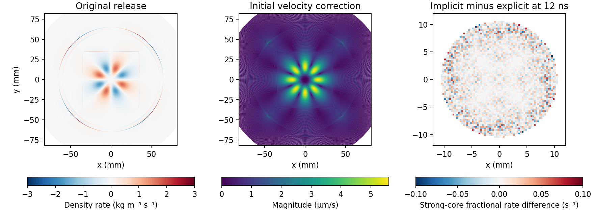

# Does balancing the mass flux let rotating water evolve accurately?

Balancing SU2’s release mass flux brought the radial acceleration below 0.001 m/s² in every 12 ns run. Local vorticity rates still disagreed by up to 0.0942 s⁻¹ against a 0.02 s⁻¹ limit. Pressure recovery and momentum-solve accuracy now limit the disk test. The interacting-ring concentration question remains open. [Method decision](#numerical-method-decision-and-one-next-experiment) · [Reproduction and raw evidence](r292/REPLAY.md)

## Where the 12 ns pressure disturbance came from

For the original R291 release on the 165,313-node relocated disk, the assembled SU2 residual predicts **0.04454 Pa** peak pressure change inside 30 mm. The explicit solution gave **0.04456 Pa**. The discrepancy over all the core nodes was 0.0000652 Pa RMS, or 0.334% of the measured disturbance RMS. The water really would resist compression of this magnitude. The compression here originates in sampling the prescribed swirl on the numerical faces. [Original experiment](CONCENTRATION_AND_WATER_STEP.md) · [Pointwise comparison summarized by region](r292/baseline.json)

| Region | Density rate RMS, kg m⁻³ s⁻¹ | Share of whole-disk squared norm | Predicted / observed peak pressure change, Pa |
|---|---:|---:|---:|
| Core, 0 < r ≤ 30 mm | 0.74151 | 73.27% | 0.04454 / 0.04456 |
| 35 mm square boundary | 0.83931 | 3.08% | 0.03107 / 0.03112 |
| 65 mm circle junction | 1.5690 | 19.95% | 0.07821 / 0.07822 |
| Full disk | 0.25972 | 100% | 0.07821 / 0.07822 |

The largest source lies on the circle junction. Most of the integrated squared error lies inside the uniform Cartesian core. Its maximum density rate there is 1.689 kg m⁻³ s⁻¹ at (−5.625, 13.75) mm and symmetry-related locations. For an edge with oriented dual normal **N** including length, SU2's centered mass flux is ρ̄ **ū**·**N**, with separate arithmetic means of the two primitive states. Even on equal squares the resulting centered differences of a sampled, non-polynomial rotating field need not cancel. We assembled these fluxes over mid-edge-to-centroid segments and compared them with an independent SU2 release evaluation in which both JST coefficients were zero. The largest nodal difference was 1.74 × 10⁻¹⁷ kg m⁻¹ s⁻¹. [Mass operator and measurement](../../physics_first/disk_mass_balance.py)

Turning the second-order JST term back on changed the **core density-rate field** by only 1.29 × 10⁻⁹ kg m⁻³ s⁻¹ RMS. The fourth-order coefficient was already zero. Replacing face density by a uniform density in the centered reconstruction changed it by 7.89 × 10⁻⁹ in the same units. Thus pressure-dependent density interpolation and numerical dissipation contribute very little to the initial mass error. The signed sum of SU2's nodal outfluxes was −6.08 × 10⁻¹⁶ kg m⁻¹ s⁻¹ against an absolute sum of 0.002715. Interior face contributions enter neighboring volumes with opposite signs. The stationary impermeable wall has zero physical mass flux.

To predict pressure, take all four actual release rates **Q̇** = −**R**/V, compute e = (ρE)/ρ − |**u**|²/2, then evaluate ṗ = (∂p/∂ρ)ₑ ρ̇ + (∂p/∂e)ρ ė by the conservative chain rule. The derivatives at the 20 °C wall state cover a background pressure variation of 17 Pa. The simpler acoustic estimate c²ρ̇ differs by only 0.0064 Pa/s RMS in the core. The full prediction gives 1.629 MPa/s RMS and 3.711 MPa/s peak there. Multiplying by 12 ns and comparing with an independent liquid flash at each endpoint tests the sign and spatial pattern as well as the magnitude. [Release residual identity](ROTATING_DISK.md#release-state-and-the-actual-solver-force)

## One initial momentum correction

We fixed the wall velocity, all nodal densities and the prescribed thermal state. Let B map nodal velocities to the integrated centered mass outflux. Its geometry, density and velocity means are the ones checked above. We sought a small correction δu in the norm ΣρV|δu|², measuring residual in Σ(R+Bδu)²/V. The right-hand side includes the measured JST flux. The linearization freezes that tiny term, and a fresh SU2 evaluation tests the full nonlinear operator on the resulting restart. Each step in the ensuing physical comparison evolves freely.

The scaled damped least-squares problem uses x = √(ρV) δu at free nodes. Scale V⁻¹ᐟ² B (ρV)⁻¹ᐟ² by its maximum absolute row sum (386,050), then minimize the squared scaled residual plus 10⁻⁸ |x|². This gives the minimum kinetic-norm correction at the achieved residual tolerance. It avoids inverting a singular divergence operator. The signed integral supplies a necessary compatibility check, and the attained weighted residual ratio of 4.36 × 10⁻⁵ tests compatibility with the fixed wall. The damping bounds the inverse even for nearly unobservable modes. LSQR took 1,344 iterations, estimated an augmented condition of 1.08 × 10⁴ and left a relative normal-equation defect of 9.72 × 10⁻¹³. A dense independent SVD on a distorted small mesh checked the minimizer. [Projection diagnostics](r292/projection.json) · [Independent tests](../../tests/test_disk_mass_balance.py)

| Release measurement | Original | Corrected |
|---|---:|---:|
| Inner density-rate RMS, kg m⁻³ s⁻¹ | 0.74151 | 0.00002139 |
| Inner pressure-rate RMS, Pa/s | 1,629,353 | 46.99 |
| Inner radial acceleration RMS, m/s² | 0.0002564 | 0.0002541 |
| Inner tangential acceleration RMS, m/s² | 0.001213 | 0.001216 |
| Tangential discrepancy from viscous reference RMS, m/s² | 0.0001780 | 0.0001985 |
| Reconstructed shear-stress norm RMS, Pa | 0.00326364 | 0.00326364 |
| Stress dissipation / solver kinetic loss, µW/m | 167.043 / 169.173 | 167.043 / 169.173 |

The full solver reduced the core continuity norm **34,674-fold**. The maximum correction, 5.564 µm/s at (11.25, −11.25) mm, was **0.00556% of peak swirl**. RMS corrections were 3.005 µm/s in the core, 0.811 µm/s at the circular seam and 0.199 µm/s beyond 82 mm, with exactly zero wall speed. The largest relative core angular-speed change was 0.00718%. Four circulation loops of 5–30 mm half-width changed by at most 0.0000512%. The relative change in disk angular momentum was +1.38 × 10⁻¹¹. The modest rise in local tangential error remains visible despite nearly identical integrated stress powers. [Release checks and radial profiles](r292/release.json)

We packed ρ(**u**+δ**u**) and added ρ δ**u**·(**u**+δ**u**/2) to the original total energy. The initialization changed kinetic energy by −17.27 pJ/m and packed total energy by −17.17 pJ/m. Subsequent inventories take the corrected release as their origin. Density remained bit-identical, ranging from 998.2071428 to 998.2071505 kg/m³. Independent recovery classified every node as liquid, with maximum errors of 0.000252 Pa and 4.31 × 10⁻¹¹ K from the prescribed pressure and temperature. Recovered inner rise was 15.90547 Pa. All release gates passed. [Historical reference](ROTATING_REFERENCE.md)

## The matched 12 ns comparison

**The projection removed the radial-acceleration failure. The local vorticity-rate failure survived.** The worst core pressure disturbance fell from 0.0446 Pa to about 0.00026 Pa, comparable to the release pressure recovery error. All four runs preserved the 15.9055 Pa inner rise, and their core radial accelerations were about one quarter of the 0.001 m/s² ceiling. The following are measured changes over the physical window, including all accepted and failed comparisons. [All checkpoints and gates](r292/endpoints.json)

| At 12 ns | Explicit 4 × 3 ns | Implicit 1 × 12 ns | Implicit 2 × 6 ns | Implicit 1 × 12 ns, tight |
|---|---:|---:|---:|---:|
| Peak core pressure disturbance, Pa | 0.000251 | 0.000254 | 0.000263 | 0.000254 |
| Radial acceleration RMS, m/s² | 0.000249 | 0.000254 | 0.000249 | 0.000254 |
| Largest strong-core fractional vorticity-rate difference from explicit, s⁻¹ | reference | **0.0942** | **0.0725** | **0.0942** |
| Change of 10 mm square-loop circulation, 10⁻¹² m²/s | −1.70089 | −1.70010 | −1.70069 | −1.70010 |
| Kinetic loss, pJ/m | 2.0301 | 2.0291 | 2.0298 | 2.0291 |
| Signed total-energy change, pJ/m | +1.3660 | −0.4526 | −0.2346 | −0.4526 |

The rate comparison uses Δω/(ω₀ Δt) independently in every strong cell. Full versus half steps differed by 0.0593 s⁻¹. The two half steps still exceeded the 0.02 s⁻¹ limit by a factor of 3.63 against explicit. One full step and its tenfold tighter repeat produced byte-identical native endpoint files. All physical steps met their respective nonlinear RMS thresholds at the second residual evaluation. Both tolerance settings accepted the same full-step iterate. That limits what can be inferred about nonlinear convergence from this control.

Stress dissipation was 167.043 µW/m throughout. Kinetic loss rate agreed with the viscous reference within 1.25%, and circulation decay within 0.19%. Summing changes of the stored nodal masses gave a largest 12 ns drift of 1.53 × 10⁻¹⁷ kg/m, below the conservative summed one-ULP mass scale of 3.57 × 10⁻¹⁵ kg/m. Wall-impulse-adjusted vector momentum defects are tabulated in the endpoint file. The raw total-energy defects were 67.3%, 22.3%, 11.6% and 22.3% of the resolved kinetic loss, respectively. Each misses the 10% criterion. The summed one-ULP total-energy scale is 468 pJ/m, about 231 times the loss. The raw budget therefore cannot resolve the small conversion to internal energy. These inventory scales bound coherent storage error and are distinct from statistical error estimates.

### What limits the local rate?

We reassembled the spatial operator at each exact endpoint using a steady, single-residual SU2 evaluation. No additional physical time elapsed. Core density-rate RMS remained (2.31–2.34) × 10⁻⁵ kg m⁻³ s⁻¹, and each Cartesian momentum-rate RMS was 0.877 kg m⁻² s⁻² to three significant figures. The spatial radial RMS was 0.000253–0.000255 m/s². Their similarity at disk scale hides a measurable error in how pressure turns individual cells. [Actual spatial residuals, root defects and signed decomposition](r292/endpoints.json)

At the cell with the largest full-step discrepancy, centered at (4.219, −9.531) mm, the signed −0.09417 s⁻¹ has three additive contributions. The full step's finite difference differs from its own backward-Euler endpoint operator by −0.01225 s⁻¹. The full and explicit endpoint spatial operators differ by −0.05982 s⁻¹. The explicit endpoint operator differs from the explicit window-average rate by −0.02210 s⁻¹. All terms use the same release circulation and a consistent conversion from conservative to velocity increments. The last term includes changes in the numerical forces sampled over time. Halving the physical step reduces the discrepancy, but these data do not give a temporal convergence order.

**The largest term at that cell comes from pressure recovery coupled to the discrete force and curl.** Across the core, SU2 recovered a full-minus-explicit pressure difference of 4.226 × 10⁻⁵ Pa RMS. Applying independently evaluated liquid EOS derivatives to the actual difference in the four stored conservative fields gives only 2.962 × 10⁻⁷ Pa RMS. The perturbations are tiny relative to the liquid state. The centered pressure-face term alone contributes −0.06150 s⁻¹ at the worst cell. Using the EOS-linearized pressure difference in the identical stencil gives +0.000143 s⁻¹ there and at most 0.000434 s⁻¹ anywhere in the strong core. Across all strong cells the remaining endpoint-operator difference after subtracting the recovered pressure contribution is at most 0.00303 s⁻¹. This isolates the effect of small pressure-recovery differences on the numerical vorticity diagnostic. It does not locate the individual rounding operation inside the conservative-to-primitive conversion or HEOS flash.

**The corrected face Jacobian and the iteration stopping test answer different questions.** R291's independent Jacobian check still applies. Re-evaluation of the conservative backward-Euler equation at the stored full-step endpoint gives an RMS defect of 0.09190 kg m⁻² s⁻² in each core momentum component, versus a momentum-storage differencing scale of 6.82 × 10⁻⁷ in those units. Its maximum fractional curl defect is 0.0891 s⁻¹ anywhere in the strong core. For the last half step the corresponding values are 0.05292 and 0.0605. Thus both pressure recovery and the accuracy of the accepted discrete root matter at the local-rate scale. The experiment supplies no unique attribution of the historical 25 µs divergence. [Original face audit](CONCENTRATION_AND_WATER_STEP.md#what-the-liquid-water-jacobian-audit-establishes) · [Historical long-step failure](WATER_SLOW_TIME.md)

## Numerical-method decision and one next experiment

Keep SU2/CoolProp as an acoustic-resolving reference and retain the projected disk as a benchmark. The tested backward-Euler route has no demonstrated path to the local slow-time accuracy required for an interacting-ring claim within this budget. The initial spatial flux error explained the startup compression and most of the radial response. After its removal, pressure recovery at nearly identical water states, discrete pressure gradients, and accepted momentum residuals still obscure local viscous rates. A longer step or integration would mix those errors with the proposed concentration signal. Physical evolution stopped at 12 ns.

**After review, implement** a one-dimensional periodic liquid-water acoustic test of the conservative, pressure-based all-Mach IMEX finite-volume method of Boscheri and Pareschi. Advance mass and total energy conservatively with common face fluxes, treat pressure and enthalpy transport implicitly, and solve the general-EOS pressure equation with the liquid EOS. Use perturbation pressure and a constant energy reference shift, evolving ρ(E−eᵣ) with its correspondingly shifted mass flux term so conservation remains algebraically equivalent. Check incremental pressure responses independently against HEOS derivatives at 20 °C, including sub-millipascal perturbations at the disk states. Compare the solution’s recovered pressure, pressure unknown and conservative energy at every acoustic checkpoint. This is a proposed liquid-water validation of a published architecture. [Boscheri and Pareschi, 2021](https://arxiv.org/abs/2008.01789)

Use the existing 0.10 m, 10 Pa periodic wave at 32/64/128 cells with independent step refinement and the 100 Pa energy control. Require phase speed and amplitude within 1% at resolved steps, with a reported reference-shifted energy precision bound. Only a pass merits the translated and untranslated 10 µm shear benchmark, requiring cross-strip pressure errors below 0.001 Pa and viscosity and loss rates within 5%. The later disk test would need a conservative curved-wall flux, the same release and local gates, a momentum/pressure-equation stopping test scaled to the local curl target, step halving and a tenfold tighter solve. Compare both acoustic-resolving and acoustic-implicit steps at the same endpoints before extending time. The next requested review concerns the one-dimensional acoustic experiment alone. [Acoustic data](ACOUSTIC_RESULT.md) · [Energy control](ACOUSTIC_100PA.md) · [Two-phase shear gates](SHEAR_QUALIFICATION.md) · [Reproduction and costs](r292/REPLAY.md)
