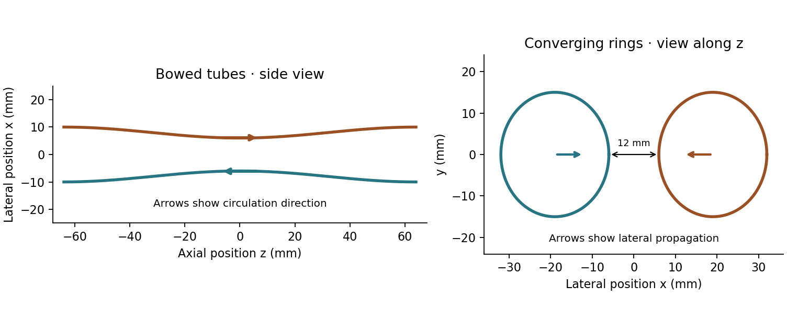

# Which unforced water experiment can distinguish stretching from thinning?

**Start with two equal rings approaching obliquely.** Their closed cores can be prepared separately, measured on release and followed through the encounter. The facing arcs interact first. The far arcs on the same rings and an independently released single ring supply controls for viscous growth. A bowed pair of tubes also offers localized strain, but end conditions and the initial bending mode are additional experimental unknowns. Schatzle measured underwater oblique ring collisions at a circulation Reynolds number near 1800 and saw cores split. That makes breakup a credible competing outcome at the proposed scale. [Schatzle's experiment](https://thesis.caltech.edu/1471/) · [Kida, Takaoka & Hussain's simulations of colliding rings](https://www.cambridge.org/core/journals/journal-of-fluid-mechanics/article/abs/collision-of-two-vortex-rings/DF24A91ECF839EBE6FC1470B77E7F961)

## Two preparations at the same core scale

Use ordinary water at 293.15 K and ambient absolute pressure near 101325 Pa, with ρ ≈ 998 kg/m³, ν = 1.0034 × 10⁻⁶ m²/s and c ≈ 1482 m/s. Choose circulation magnitude Γ = 1.8 × 10⁻³ m²/s and Gaussian vorticity e-folding radius a = 2 mm at release. In a straight core, ω₀ = Γ/(πa²) ≈ 143 s⁻¹ and the maximum swirl is 0.091 m/s at 1.121a. Thus ReΓ ≈ 1794 and the swirl Mach number is about 0.000062. For a freely diffusing straight core, d(a²)/dt = 4ν. Initially the fractional peak decay rate is 4ν/a² ≈ 1.00 s⁻¹. In locally uniform incompressible axial extension at rate s, d(a²)/dt ≈ 4ν − s a². This scale estimates how much axial strain the water must generate. Curvature, ellipticity and overlap call for measuring the full budgets. [Water model and transport](PHYSICAL_MODEL.md) · [Viscous spreading reference](SPREADING_RESULT.md)

| | Bowed counter-rotating tubes | Obliquely converging rings |
|---|---|---|
| Geometry at release | Over one axial period λ = 128 mm, x±(z) = ±[8 − 2 cos(2πz/λ)] mm, y = 0, circulation directed along increasing z on one leg and decreasing z on the other. The separation varies from 12 to 20 mm. | Ring radius R = 15 mm. Centers at (±19, 0, 0) mm. Unit propagation normals (∓sin 30°, 0, cos 30°). Circulation follows the right-hand rule about each normal. The included angle is 60° and the near arcs are initially 12.02 mm apart. |
| Mechanical preparation | Roll up two opposite free shear layers with a synchronized pair of rotating plates in a long tank. A small spanwise variation of release-edge position seeds the bow. Stop the plates, measure the actual centerlines, axial flow and Γ in the interior, and exclude end regions. Rotating plates have produced measurable three-dimensional instabilities in water. [Leweke & Williamson](https://doi.org/10.1017/S0022112097008331) | Aim two submerged circular piston nozzles along the normals. Start with diameter 25 mm, expelled stroke 50 mm and exit speed near 0.072 m/s over the stroke. The slug estimate ½∫U²dt gives Γ ≈ 0.0018 m²/s for nearly constant speed. Use smooth ramps, record the waveform, then stop both pistons. In a filled vessel, accommodate displaced volume through a remote compensating piston or return reservoir during formation and close the return at release. Set placement and timing from single-ring measurements so detached rings attain the specified centers, a, R and Γ together. L/D = 2 is below the observed long-stroke pinch-off range. Measure any trailing jet or stopping vortex before accepting an isolated-ring model. [Gharib, Rambod & Shariff](https://doi.org/10.1017/S0022112097008410) |
| Speed and source of strain | Straight sections 16 mm apart induce translation Γ/(2πd) ≈ 0.018 m/s. An exactly parallel straight pair has zero axial stretching. With the bow, different sections translate at different speeds, tilt and change arclength. The partner's velocity-gradient scale Γ/(2πd²) is 1.1 s⁻¹ at 16 mm. Its projection on the vortex direction must be measured. Long-wave bending and short-wave elliptic instabilities compete. [Crow's pair stability analysis](https://doi.org/10.2514/3.6083) | A thin Gaussian ring's isolated speed is Γ[ln(8R/a) − 0.558]/(4πR) ≈ 0.034 m/s. Straight flight would close the initial gap in about 0.36 s. Mutual induction changes both the speed and the shape. At the near arcs the local parallel-filament gradient scale is about 2 s⁻¹. Curvature and differential induction can lengthen selected arcs, flatten cores and later bring opposite vorticity into diffusive contact. [Saffman's ring velocity](https://doi.org/10.1002/sapm1970494371) · [Collision calculations](https://www.cambridge.org/core/journals/journal-of-fluid-mechanics/article/abs/collision-of-two-vortex-rings/DF24A91ECF839EBE6FC1470B77E7F961) |
| Energy and impulse scales | Pair energy per wavelength is of order ρΓ²λ ln(d/a)/(2π) ≈ 0.14 mJ, a straight-pair logarithmic estimate. The opposite circulations cancel the far-field monopole. A translating dipole carries impulse per length of order ρΓd. | Isolated ring energy is of order ρΓ²R[ln(8R/a) + O(1)]/2, or order 0.1 mJ per ring. Each impulse is approximately ρΓπR² = 0.00127 N s along its normal. Transverse impulses cancel and forward components add. Include the mutual kinetic-energy cross term when computing the pair inventory. |

The plates or pistons supply the initial energy and impulse. In the subsequent closed, adiabatic problem, total energy is conserved, while viscosity converts mechanical energy to heat and pressure work can exchange internal and kinetic energy. Stationary tank walls can take impulse without supplying power. Hydrodynamic impulse of a compact vortex distribution and the integral of momentum in a periodic box have different boundary terms. Measure each with its own definition. Local Γ through a tracked section can change through viscous transport, baroclinicity and exchange with neighbouring cores. Compute ∮u·dl and the corresponding signed vorticity flux. In the nearly barotropic liquid their agreement and the circulation budget put a quantitative constraint on any claimed narrowing. [Conservation laws and boundary work](PHYSICAL_MODEL.md)

## Release state and first physical simulation

Construct smooth, solenoidal vorticity by convolving each oriented centerline with a normalized three-dimensional Gaussian, Gₐ(x) = exp(−|x|²/a²)/(π³ᐟ²a³). Set ω(x) = Σ Γᵢ ∮ Gₐ(x−X) dX. Closure cancels the endpoint term in div ω. Measure the resulting section circulation and widths on the curved cores against the release targets. Recover the decaying velocity by Biot–Savart in free space. The rings have dipolar far velocity and finite kinetic energy. For the tubes, wrap both lines through the axial period and use a periodized kernel in a 320 × 320 × 128 mm periodic box with zero mean velocity. Opposite winding cancels mean vorticity. This models the central wavelength of long plates. Check the measured axial mode and finite-span effects before a tank comparison.

For the rings use a 320 mm periodic cube as a first approximation to unbounded water, with periodized data and specified zero mean velocity. Test image effects against the free-space field initially and by enlarging the box before interpreting an encounter. A laboratory comparison uses a filled tank with stationary no-slip walls after release. Measure the ambient return flow, hydrostatic reference pressure at the ring depth, and acoustic reflections. The first idealization omits gravity and nozzle wakes. Compare single-ring trajectories and environmental strain to their tank counterparts to quantify that choice.

Initialize the compressible pressure with the leading low-Mach balance Δp′ = −ρ₀ ∂ᵢuⱼ ∂ⱼuᵢ, with zero mean p′ in the periodic domain. Use p = p₀ + p′ and uniform T₀ for the liquid EOS, then store (ρ, ρu, ρ[e + |u|²/2]). Check the EOS round trip, periodic pressure residual and acoustic adjustment. A superposition of the two isolated pressure depressions misses the interaction term. This initialization supplies the initial mechanical pressure required by the velocity field to leading order. Subsequent p, T and ρ evolve with the conservative equations. Use the true sound speed, physical shear viscosity and heat conduction. [Water constitutive assumptions, including baseline bulk viscosity](PHYSICAL_MODEL.md)

Eventually follow one pair and a matched isolated ring from release through 0.5 s or the loss of resolvable core identity, whichever comes first. The computed velocity determines the encounter time. Record facing and far arcs throughout. Volumetric particle-image velocimetry can recover the velocity gradients and circulation, subject to spatial filtering. Compare CFD after applying the same spatial and temporal averaging. Dye locates material and can remain visible after vorticity has diffused away.

## What would count as concentration?

- In local planes normal to each tracked centerline, measure signed circulation, peak |ω|, radius enclosing half of the parent circulation and both principal second-moment widths of its same-signed axial vorticity. For an undistorted Gaussian, r₅₀ = a√ln 2. Report peak gain relative to release, minimum r₅₀/r₅₀(0), location and duration, with grid or measurement uncertainty. Follow material arc markers and their separation. Report cross-sectional area as well as the minor width so flattening alone cannot imitate collapse. Stop assigning a single radius when the core splits or opposite-signed patches overlap.
- With D the symmetric velocity gradient, the axial extension rate is s = ω̂·Dω̂. The material enstrophy budget contains ω·Dω, −|ω|² div u, the baroclinic contribution ω·(∇ρ × ∇p)/ρ² and ω·curl[(div τ)/ρ]. For nearly uniform ρ and μ the last term is νΔ(|ω|²/2) − ν|∇ω|². Measure transport and destruction separately and compare their sum with the directly differenced material derivative. In an Eulerian subvolume include advective flux. Also record pressure minima, dilatation, density, temperature, viscous heat and signed mass, momentum and total-energy inventories.
- Claim transient thinning only if a tracked core's equivalent area and r₅₀ fall **below their release values** while its material segment elongates, its circulation is accounted for and peak vorticity rises beyond uncertainty. Slower growth than the single ring shows suppression of diffusion. Peak growth alone can reflect overlapping cores, intensification in one lobe or compression. A converged circulation transfer into bridges and a change in vortex-line connections across several neighbouring sections indicate reconnection. Multiple persistent cores and loss of the parent identify breakup. Both can terminate a thinning episode. [Measured core splitting](https://thesis.caltech.edu/1471/) · [Experimental ring reconnection](https://doi.org/10.1038/357225a0)
- Treat a one-cell peak, grid-locked or phase-sensitive structures, a changing bridge under refinement, poor budget closure or a pressure disturbance traveling at c as separate explanations to test. Track absolute p − p_sat(T) and EOS phase. At the initial swirl speed ρU² is only about 8 Pa against roughly 99 kPa of saturation margin. A postulated density or temperature change below the EOS, storage or instrument resolution needs an uncertainty bound.

## Validation before evolving the pair

The periodic shear test qualifies one mode. A rotating mesh field also needs a resolved centrifugal pressure gradient, a discrete momentum residual at release, and an independently converged isolated viscous core. Verify core radius, circulation, pressure, translation speed and kinetic loss on a single ring before attributing any change to its partner. Use independent space and time refinement, a half-cell translation/rotation, box enlargement and a pressure/energy precision check. Resolve both principal core widths and any inter-core layer throughout. Require changes in the measured thinning and net production to be smaller than the claimed effect, including PIV uncertainty when comparing with a tank. A practical seconds-scale compressible run also needs a time-accurate acoustic-implicit or all-speed step qualified against short explicit segments and tighter inner tolerance. [Spatial qualification](SHEAR_QUALIFICATION.md) · [Open radial pressure test](VORTEX_EQUILIBRIUM.md)

**One next calculation for review.** Compute the *initial* strain and viscous vorticity tendency around the two specified circles in free space, with the same isolated ring as a control. Use the Gaussian-convolved Biot–Savart kernel at 128, 256 and 512 quadrature points per loop. At 128 common azimuths evaluate s, the isolated and mutual contributions using the same tangent, and the signed viscous rate ν ω̂·Δω/|ω| from derivatives of the Gaussian. Use the actual vorticity direction for the full peak-rate budget and record its angle to the geometric tangent. Check the partner's strain by direct differentiation and a centered velocity difference at a/8 and a/16. Require the two fine quadratures and the independent gradient estimate to agree within 0.02 s⁻¹ in s, and the fine quadratures within 0.02 s⁻¹ in the viscous rate. Verify the mirror-related arcs, isolated-ring azimuthal invariance and negligible div u. Report the largest and smallest net material rates and their locations, even if all are negative. This evaluates whether the prepared geometry initially supplies stretching comparable to diffusion. It cannot determine the minimum subsequent radius. Stop with that table and a review of the geometry before any flow evolution.
