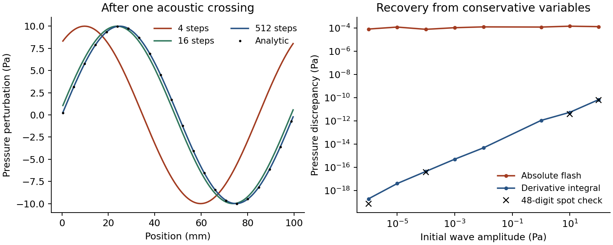

# A conservative pressure step for sound in liquid water

**R293 decision · Pass for resolved 1D acoustics.** A 10 Pa wave crossed 0.10 m of water at 1481.73 m/s on the finest grid, against the liquid-EOS prediction of 1482.35 m/s. It returned with amplitude 9.9999982 Pa. Evolving reference-relative density and energy made the largest quarter-period shifted-energy defect on that run **1.57 × 10⁻²¹ J/m²**, compared with **1.04 × 10⁻⁹ J/m²** in the archived SU2 measurement. At four physical steps per crossing the pressure wave retained its amplitude but traveled 15.26% too slowly. The result supports a transverse shear test. Accurate slow-time evolution of rotating water remains open. [Archived 10 Pa result](ACOUSTIC_RESULT.md) · [100 Pa control](ACOUSTIC_100PA.md) · [Fields and replay](r293/REPLAY.md)



## The published split and the version tested

In dimensional 1D notation write momentum density m = ρu, kinetic energy per mass K = u²/2, h = e+p/ρ and E = e+K. In Boscheri and Pareschi's first-order construction the mass flux m is explicit. Momentum advection mu and kinetic energy transport mK are explicit. The new pressure corrects the advected momentum, m⁺ = m* − Δt ∂ₓp⁺. The enthalpy flux uses old enthalpy and new momentum. Their discrete enthalpy includes a density ratio. The energy storage uses ρ⁺e(ρ⁺,p⁺) + uⁿm⁺/2. Substitution of the corrected momentum into this balance produces a pressure equation containing a local nonlinear EOS term, a first derivative from kinetic storage and a weighted elliptic term −Δt² ∂ₓ(h ∂ₓp⁺). Density is known when they solve it. They use a nested Newton approach for the general EOS, compact spatial pressure operators, high-order IMEX stages and CWENO reconstruction. See equations 22–36 and 61–67. [Boscheri and Pareschi](https://arxiv.org/html/2008.01789)

This experiment uses their pressure-through-energy idea with **a different mass time level, centered midpoint fluxes, physical endpoint kinetic energy and a chord iteration**. Here pressure corrects mass as well as enthalpy transport. This makes both fluxes use exactly the same face momentum. It also puts the strong liquid density derivative inside the implicit acoustic operator. The implementation covers smooth near-ambient periodic liquid and finite acoustic steps. The paper's general all-Mach, shock and asymptotic-preserving results do not establish those properties for this variant. [Reference solver](../../physics_first/liquid_imex.py)

### Conservative variables and face equations

Store r = ρ−ρ₀, m and H = ρ(E−e₀), with e₀ fixed at the reference water state. Subtract e₀ times the mass equation from the absolute energy equation. The resulting physical flux is

```
F_H = F_ρE − e₀ F_ρ = (H+p)u − τu − k ∂ₓT
    = (h−e₀)m + mK − τu − k ∂ₓT.
```

Store π = p−p₀ as the pressure unknown. Periodicity permits dropping the constant p₀ from momentum-flux differences. Enthalpy retains **p₀+π**. Reference density drops out of the storage difference in continuity and reappears in velocity, kinetic energy and the EOS. Here τ = (4/3)μ ∂ₓu. The constant shear viscosity, zero added bulk viscosity and Fourier conductivity match the archived benchmark. Gravity, driving, wall work and heat sources are absent.

Let B denote the arithmetic mean of neighboring cells at their common face, δ the right-minus-left face difference divided by Δx, and G the adjacent-cell gradient at the face. First predict conservative cell values at half time by a half forward-Euler step using the old physical fluxes. At that predicted state (asterisk) evaluate the known face quantities

```
A = B(mu)* − τ*                      τ* = (4/3) μ G u*
W = B(mK)* − τ* B(u*) − k G T*
h_s = B[e*−e₀ + (p₀+π*)/ρ*].
```

For a trial endpoint π⁺, form the following *same* faces and apply their signed differences to neighboring cells.

```
F_m = A + B[(πⁿ+π⁺)/2]                m⁺ = mⁿ − Δt δF_m
F_ρ = B[(mⁿ+m⁺)/2]                    r⁺ = rⁿ − Δt δF_ρ
F_H = W + h_s F_ρ                     H⁺ = Hⁿ − Δt δF_H
g(π⁺) = π⁺ − π_EOS(r⁺, H⁺/ρ⁺ − (m⁺/ρ⁺)²/2) = 0.
```

The physical unshifted discrete energy flux is W + (h_s+e₀)F_ρ. This identity requires the actual continuity flux. With the paper's explicit mass flux simply replacing h by h−e₀ in an implicit enthalpy flux would generally subtract a different amount. The test reconstructs the absolute energy flux separately, including stress work and heat transport, and compares its cellwise balance to ΔH+e₀Δr on a non-isentropic odd-cell mesh. Uniform translating water is preserved exactly. [Independent tests](../../tests/test_liquid_imex.py)

Linearizing g about resting water gives J₀ = I−(c₀Δt/2)²(δB)². In Fourier mode θ its eigenvalue is 1+[c₀Δt sin θ/(2Δx)]². Each chord iteration solves J₀Δπ = −g by FFT, then reevaluates the **nonlinear** energy, density, momentum and EOS at the corrected pressure. The code measures both the physical-space linear residual and the nonlinear pressure closure in Pa. Accepted conservative values come from flux differences. The constant Jacobian is a near-rest solver choice. Its spectrum also exposes a limitation of the collocated stencil. An alternating pressure at the grid Nyquist frequency has zero centered gradient. The smooth acoustic mode does not test suppression of that mode at a seam or wall.

## Recovering a small pressure change

HEOS Water at 101325 Pa and 293.15 K gives ρ₀ = 998.207150468 kg/m³, e₀ = 83905.7938639 J/kg and c₀ = 1482.34617485 m/s. Let b = H/ρ−u²/2. To obtain pressure and temperature increments, integrate their differentials along the straight segment in (ρ,e) from (ρ₀,e₀) to (ρ₀+r,e₀+b). At its midpoint evaluate HEOS Helmholtz derivatives in (ρ,T). The midpoint temperature uses the reference tangent. The implementation approximates the integrals by midpoint quadrature,

```
ΔT = (b − e_ρ|T r)/c_v
π  = p_ρ|T r + p_T|ρ ΔT .
```

These are finite increments with coefficients reevaluated for each cell and pressure iterate. The quadrature and midpoint-temperature approximation have cubic local error in excursion size. No temperature or sound-speed rescaling enters the equations. The acoustic identity c² = p_ρ|e + p_e|ρ p/ρ² restores the liquid compressibility. Independent symmetric absolute-flash secants gave 2197339.089 versus the HEOS derivative 2197339.158 Pa/(kg/m³) and 108.414292 versus 108.414297 Pa/(J/kg). The secant half-widths were 0.001 kg/m³ and 0.5 J/kg. [Physical EOS](https://iapws.org/technical-guidance/release/IAPWS-95) · [Water backend](https://coolprop.org/fluid_properties/fluids/Water.html)

Three independent readings check the implicit pressure. At every checkpoint a separate density/internal-energy flash supplies absolute p, T, sound speed and phase. The same reader integrates **p_ρ|e dr + p_e|ρ de** with Simpson quadrature and three density–energy flashes, independently of the midpoint implementation. For eight signed spot checks a separate 48-decimal-digit evaluator sums the ideal and residual IAPWS Helmholtz terms with the installed water coefficients. It differences Helmholtz energy, solves for its own reference density at (p₀,T₀), adds the stored perturbations and inverts its own internal energy for T. It calls no CoolProp property routine to recover these pressures. Thus the decimal comparison includes a fresh EOS inversion and shares only the equation and coefficients. It tests perturbations about a common physical reference, not absolute agreement of the two floating-point reference representations. [Decimal check](../../physics_first/liquid_helmholtz_check.py) · [Signed samples](r293/decimal.json)

| One-step wave input | Max implicit vs absolute flash | Max implicit vs Simpson recovery | Max implicit vs decimal at two cells |
|---:|---:|---:|---:|
| 100 Pa | 1.34 × 10⁻⁴ Pa | 6.79 × 10⁻¹¹ Pa | 6.32 × 10⁻¹¹ Pa |
| 10 Pa | 1.46 × 10⁻⁴ Pa | 5.49 × 10⁻¹² Pa | 3.77 × 10⁻¹² Pa |
| 0.0001 Pa | 7.86 × 10⁻⁵ Pa | 4.44 × 10⁻¹⁷ Pa | 3.74 × 10⁻¹⁷ Pa |
| 0.000001 Pa | 8.29 × 10⁻⁵ Pa | 1.89 × 10⁻¹⁹ Pa | 7.39 × 10⁻²⁰ Pa |

These probes use 16 cells, one 1/64-period step and a pressure tolerance scaled to amplitude. At 0.0001 Pa the nonlinear residual was 1.36 × 10⁻²⁰ Pa. Forming absolute ρ and subtracting ρ₀ lost up to 5.12 × 10⁻¹⁴ kg/m³ (about 1.1 × 10⁻⁷ Pa through the density derivative). Repacking e cost up to 4.60 × 10⁻¹² J/kg. Even the nominal PT flash returns p−101325 ≈ +3.03 × 10⁻⁵ Pa. These scales distinguish storage subtraction, absolute EOS evaluation and pressure iteration. Binary64 absolute evaluation dominates the near-identical-state pressure discrepancy here. The experiment cannot assign all of it to a single operation inside CoolProp. The relative path demonstrably preserves the sub-millipascal response about ambient water. [Full amplitude sweep, loss and residuals](r293/results.json)

## Reproducing the acoustic wave

Each run covers one 67.4606 µs crossing of the 0.10 m periodic line. The initial sinusoid is center sampled with the archived half-cell offset. Integrate dρ/dp = 1/c² and de/dp = p/(ρ²c²) by midpoint quadrature on the HEOS reference isentrope. Use u = ±π/(ρ₀c₀). Only initialization uses that relation. Subsequent motion follows the unforced fluxes. The phase speed comes from the signed unwrapped first Fourier mode of independently recovered pressure at release and each quarter crossing. The backward waves use the opposite velocity and the same initial pressure. The absolute-flash Fourier mode independently meets both 1% gates in every run. [Inputs, modes and states](r293/REPLAY.md)

| Cells | Steps per crossing | 10 Pa speed, m/s | Archived SU2 speed, m/s | 10 Pa amplitude, Pa | Archived SU2 amplitude, Pa |
|---:|---:|---:|---:|---:|---:|
| 32 | 256 | 1472.767 | 1472.99 | 9.99999821 | 9.98547 |
| 32 | 512 | 1472.821 | 1472.88 | 9.99999821 | 9.98540 |
| 64 | 256 | 1479.892 | 1480.11 | 9.99999822 | 9.99837 |
| 64 | 512 | 1479.948 | 1480.00 | 9.99999822 | 9.99827 |
| 128 | 256 | 1481.677 | 1481.90 | 9.99999822 | 9.99990 |
| 128 | 512 | 1481.732 | 1481.79 | 9.99999822 | 9.99980 |

At 100 Pa the 128/512 result was 99.9999822 Pa and 1481.732 m/s, versus 99.99804 Pa and 1481.788 m/s in SU2. Across both signs, both amplitudes, three grids and **128/256/512 independent steps per crossing**, worst speed error was 0.6611%. Worst amplitude error was 0.000018% using incremental recovery and 0.000127% using absolute flash. At fixed 512 steps, successive grid differences gave speed order 1.9974. At fixed 128 cells, successive time-step differences gave 1.9995. Amplitude self-convergence orders were 2.001–2.002 in space and 1.998–2.003 in time. The density Fourier mode independently confirmed both phase orders. At each saved cell, the absolute flash returned liquid water. Across resolved runs the ranges were 101225.02–101424.98 Pa, 293.14999855–293.15000146 K and 1482.346005–1482.346345 m/s.

The largest resolved nonlinear and linear residuals were 1.96 × 10⁻¹¹ and 5.33 × 10⁻¹⁵ Pa. At 128/256 and 10 Pa a tenfold tighter tolerance reduced the maximum nonlinear residual from 1.45 × 10⁻¹¹ to 5.33 × 10⁻¹⁵ Pa. Speed changed by less than 10⁻¹¹ m/s and amplitude by less than 10⁻¹³ Pa. Across all resolved checkpoints the implicit pressure differed from independent Simpson recovery by at most 8.15 × 10⁻¹¹ Pa and from absolute flash by at most 0.000172 Pa. The resolved speed error is explained by spatial and temporal dispersion.

### Energy per unit cross-sectional area

The background internal-energy inventory is 8.376 × 10⁶ J/m². The initial acoustic energy, obtained from the integral of π²/(2ρ₀c₀²) + ρ₀u²/2, is **2.280 × 10⁻⁹ J/m² at 10 Pa** and **2.280 × 10⁻⁷ J/m² at 100 Pa**. The binary64 spacing of absolute energy density is 1.49 × 10⁻⁸ J/m³. The shifted 10 Pa one-step probe had spacing 5.42 × 10⁻²⁰ J/m³ at maximum |H|. The density shift also matters because reconstructing absolute energy multiplies density differences by e₀.

| 128 cells, 512 steps, right-moving | 10 Pa | 100 Pa |
|---|---:|---:|
| Maximum quarter-period mass defect (kg/m²) | 3.26 × 10⁻²³ | 2.91 × 10⁻²² |
| Momentum defect (kg/(m s)) | 4.33 × 10⁻²⁰ | 1.72 × 10⁻¹⁹ |
| Shifted-energy defect (J/m²) | 1.57 × 10⁻²¹ | 9.40 × 10⁻²¹ |
| Same defect / initial acoustic energy | 6.90 × 10⁻¹³ | 4.12 × 10⁻¹⁴ |
| Archived SU2 fraction | 0.4541 | 0.002805 |
| Unshifted defect from ΔH+e₀Δr (J/m²) | 2.73 × 10⁻¹⁸ | 2.44 × 10⁻¹⁷ |
| Unshifted defect after packing absolute ρE to binary64 (J/m²) | 2.10 × 10⁻¹⁰ | 1.05 × 10⁻¹⁰ |

Every face is internal to the periodic box. The signed integrated boundary flux is zero. For audit we independently difference the returned face values in extended precision at every update and accumulate absolute cell discrepancies. A conservative floating-point budget sums 4εΔx[|U|+(Δt/Δx)(|F_left|+|F_right|)] per cell and step, component by component. For the finest 10 Pa run the absolute local discrepancies summed to 5.32 × 10⁻¹⁹ J/m² for H against a 2.01 × 10⁻¹⁷ J/m² whole-trip allowance. Every mass, momentum, shifted and reconstructed unshifted inventory passed. Over all 10 Pa runs the largest quarter-period shifted defect was 4.28 × 10⁻²¹ J/m². SU2 used native residuals and absolute-energy storage on a strip. The new measurement uses actual 1D shared faces and shifted storage. Repacking the **same new states** to absolute doubles reproduces a large loss in accounting precision. [Per-run precision budgets](r293/solves.json)

The finest wave-energy diagnostic fell by 3.56 × 10⁻⁷ of its initial value. The linear thermoviscous prediction for the specified zero bulk viscosity is an amplitude factor exp[−Γ(2π/L)² L/c₀] = 0.99999982172, with Γ = [4μ/(3ρ₀) + k(cₚ/cᵥ−1)/(ρ₀cₚ)]/2. The observed 10 Pa factor was 0.99999982168. This agreement concerns attenuation of a longitudinal mode under the chosen transport model. Physical viscous heating would require an independent irreversible internal-energy or entropy budget separating reversible compression, heat conduction and numerical dissipation. R293 establishes conservative closure and wave attenuation only.

## Larger steps and the next physical gate

The larger steps used 128 cells and the 10 Pa right-moving wave after the resolved matrix passed. Matched zero-viscosity, zero-conductivity controls isolate numerical amplitude change.

| Steps per crossing | Acoustic CFL | Signed speed error | Final physical amplitude | Inviscid numerical amplitude change |
|---:|---:|---:|---:|---:|
| 16 | 8 | −1.295% | 9.99999819 Pa | −7.7 × 10⁻¹³ Pa |
| 4 | 32 | −15.256% | 9.99999800 Pa | +8.9 × 10⁻¹⁴ Pa |

Both remained bounded for one crossing, with maximum endpoint pressure magnitude below 10.001 Pa over every step and liquid at all checkpoints. The inviscid centered trapezoidal linearization has unit amplification magnitude and phase advance 2 atan[(c₀Δt/2Δx) sin(2π/N)]. It predicts the phase lag. The method carries unresolved acoustic oscillations with little damping. No large-step stability or accuracy claim extends beyond this smooth fundamental mode and this run duration. Daisy measured **15.45 s wall time and 122792 KiB peak RSS** for all 36 resolved integrations, five controls and checkpoint measurements. A separate fresh 128/512 integration with balance diagnostics took 1.32 s and 122540 KiB. Neither timing estimates a 2D pressure solve. [Resource measurements](r293/resources.txt)

**Recommended next experiment after review: the archived transverse shear wave in its two spatial phases.** It directly tests whether the improved incremental pressure survives a second momentum component and the physical shear stress. Carry forward the shared oriented mass flux, shift identity, EOS, pressure closure and independent per-face inventories. Extend to the vector stress tensor, tangential momentum transport, matched viscous work, conductive flux and a consistent multidimensional divergence/gradient pair. Check the alternating pressure mode as well as the seam under translation. Compare both 10 µm phases on the archived grids with fixed physical steps and independent halving, checking ≤0.001 Pa cross-strip range and aligned differences at every checkpoint, viscosity and loss rates within 5%, and kinetic-to-internal energy closure. [Shear measurements and historical failures](SHEAR_QUALIFICATION.md)

The rotating disk remains a later gate. Its wall needs conservative geometry, no-slip viscous traction and zero normal mass/heat flux. Its pressure operator and boundaries need a solver beyond the periodic 1D FFT. Re-evaluate discrete continuity of the balanced release with the new face operator. Match wall impulse, angular momentum, stress power and local curl of the conservative momentum residual as well as total energy. Then compare the same 12 ns full, half and tighter solves against the acoustic-resolving reference, preserving the 0.05 Pa, 0.001 m/s² and 0.02 s⁻¹ local gates before extending physical time. One-dimensional phase accuracy gives no disk vorticity-rate estimate. Scientific review precedes either 2D workload. [R292 release and failed local-rate comparison](DISK_MASS_BALANCE.md)
