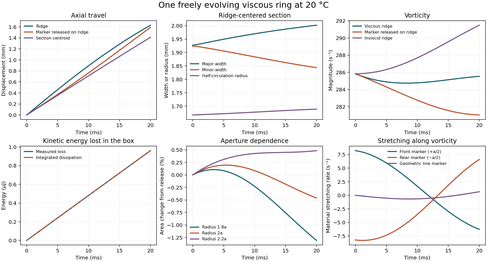

# An isolated water ring in its first 20 milliseconds

**The ring translated and its core flattened during 20 ms of unforced evolution.** The vorticity ridge traveled 1.631 mm. The shorter principal width decreased by 4.17%, the longer width increased by 3.87%, and the radius containing half the circulation grew by 1.32%. Changing the measurement aperture reverses the sign of the small sectional-area change. The isolated ring supplies a converged low-Mach velocity and intensity control. A claim of core contraction remains unresolved. These results describe a constant-density viscous solution. Acoustics, heating and the water equation of state require a compressible calculation.



[41-sample primary time history](ring-evolution/n16_L80_s4.csv) · [Travel, speed and ring lengths](ring-evolution/translation.csv) · [Uncertainty through time](ring-evolution/uncertainty.csv) · [Meridional field samples](ring-evolution/n16_L80_s4_fields.npz)

## Equations and finite boundary

The origin is fixed at the initial ring center. Positive z follows the oriented left ring's normal. Density is fixed at 998.2 kg/m³ and ν at 1.003395 × 10⁻⁶ m²/s for the 20 °C reference. There is no swirl velocity, forcing or moving wall. Azimuthal vorticity is positive. In smooth axisymmetric flow ωθ = rη with η even in r. Taking the curl of incompressible momentum gives Dωθ/Dt = (uᵣ/r)ωθ + ν(Δ − 1/r²)ωθ. The radial motion cancels the stretching term in D(ωθ/r)/Dt. The result is Dη/Dt = νLη with L = ∂rr + (3/r)∂r + ∂zz. The dimensional material stretching of ωθ survives when it is reconstructed. [Mathematical setting](https://arxiv.org/abs/1609.02030)

Write ψ = r²φ. The streamfunction equation becomes Lφ = −η. At r = 0 the radial part of Lf is 4fᵣᵣ for either even scalar, by Taylor expansion. Velocity is uᵣ = −rφ𝓏, u𝓏 = 2φ + rφᵣ. On the axis uᵣ = 0, u𝓏 = 2φ and lim uᵣ/r = −φ𝓏. On the grid the two mass fluxes use the same tensor derivative of ψ. Their mixed derivatives commute. The axial velocity on the axis uses the analytic limit. Even reflection supplies the radial stencils for η and φ. This prevents singular floating-point divisions.

The velocity outside a compact ring decays in free space. For φ, L is the five-dimensional Laplacian with four radial dimensions and one axial dimension. Its Newton kernel is 1/(8π²d³). Averaging over the source three-sphere (area 2π²) and expanding in source/observer distance gives the boundary potential. For s = √(r²+z²) and c = z/s, moment n is ∫ r′³η s′ⁿ Cₙ(c′) dr′dz′ / [4 Cₙ(1)]. Multiply by Cₙ(c)/sⁿ⁺³ and sum n = 0 through 6, with Gegenbauer index 3/2. The code scales distances by the box radius. It recomputes all moments at each RK stage from the current flow. Through-flow carries energy across each finite face. Truncating the multipole series, quadrature of its moments, the exterior grid spacing and setting the remote η trace to its negligible release value are boundary approximations. Domain doubling tests their combined influence. The Gaussian extends mathematically beyond the box.

Five-node local polynomial differences act on a tensor mesh, uniform through r = 22 mm and |z| = 8 mm, then stretched with a sinh mapping. SciPy SuperLU factors the interior elliptic operator once per grid. A three-stage, third-order Runge–Kutta method advances both η and the carried marker coordinates, updating velocity at every stage. The release uses the scaled modified Bessel I₁ angular integral of the archived Gaussian line convolution, including its finite analytic axis limit. Independent checks call the original 512-segment Cartesian quadrature. [Solver](../../physics_first/axis_ring.py) · [Verification script](../../physics_first/axis_ring_verify.py)

## Verification before evolution

A Gaussian potential crossing the axis supplies an exact source and Dirichlet trace. For a second independent problem, a Gaussian pulse of η centered on the axis diffuses in five dimensions. Its width squared grows by 4νt and its amplitude decays as (1+4νt/a²)⁻⁵ᐟ². Error below is normalized by the actual 5 ms change. Coupled ring pilot endpoints at 0.5 ms use 2, 4 and 8 steps, holding space fixed. The material-rate check extrapolates the first-step difference of log vorticity on moving markers to zero step. The count is 73 strong points among 97 release probes.

| Cells/a | Max potential error | Axis axial-velocity error | Heat change relative error | Max velocity error (m/s) | Max projected / material rate errors (s⁻¹) | Time order |
|---:|---:|---:|---:|---:|---:|---:|
|8|2.11e−6|4.21e−6|3.32e−4|1.10e−5|0.00109 / **0.02181**|3.010|
|12|4.11e−7|8.21e−7|6.85e−5|2.17e−6|0.000194 / 0.00748|3.001|
|16|1.29e−7|2.58e−7|2.20e−5|6.86e−7|0.0000624 / 0.00262|2.996|

The coarse material rate exceeds 0.02 s⁻¹ and is diagnostic only. Both required finer levels pass. In the doubled box the a/12 line speed changes by 3.19 × 10⁻⁸ m/s. Fine release line speed is 0.06457756 m/s. The signed circulation and axial impulse agree with Γ and ρπΓR² within 1.1 × 10⁻¹⁰ relative across the tests. The maximum manufactured divergence away from the axis, including near-axis nodes, is below 9 × 10⁻¹¹ s⁻¹. The axis cancellation follows from 2∂ᵣuᵣ + ∂𝓏u𝓏 = 0. Four verification cases took 5.21 s together and peaked at 405 MiB RSS on daisy. [All measurements and gates](ring-evolution/qualification.json)

## What moved, stretched and spread

The release has R = 15 mm, a = 2 mm and Γ = 0.0036 m²/s. At its geometric centerline the independent velocity is +0.06457767 m/s and the fractional material vorticity rate is −1.00677 s⁻¹. The archived 4 mm disk centered there contains 0.003533146 m²/s, with principal widths 1.923641 and 1.927089 mm. At a/16 the measured signed flux differs by 4.0 × 10⁻⁸ Γ and the two widths by about 0.00021 µm. The vorticity maximum starts 0.06651 mm inward, so a disk centered on the ridge has slightly different release values. Each change below uses its own release baseline. [Archived release](ISOLATED_RING_CONTROL.md) · [Matched controls and budgets](ring-evolution/analysis.json)

| Quantity, a/16 and Δt = 125 µs | Release | 20 ms |
|---|---:|---:|
| Ridge radial position / axial travel (mm) | 14.93349 / 0 | 15.20826 / 1.63071 |
| Axial ridge speed, differenced from ridge positions (m/s) | 0.09302 | 0.06446 |
| Axial speed of geometric-line fluid marker (m/s) | 0.06458 | 0.09096 |
| Tracked section centroid axial travel (mm) | 0 | 1.41084 |
| Peak / geometric-line material vorticity (s⁻¹) | 285.836 / 285.521 | 285.536 / 278.414 |
| Minor / major principal widths (mm) | 1.92373 / 1.92738 | 1.84361 / 2.00190 |
| Covariance ellipse area (mm²) | 11.64831 | 11.59472 |
| Radius enclosing half the full release Γ (mm) | 1.66699 | 1.68895 |
| Signed flux in the ridge-centered 2a disk (m²/s) | 0.00353345 | 0.00349711 |
| Ridge / geometric-line material circumference (mm) | 93.8299 / 94.2478 | 95.5563 / 93.6840 |
| Finite-box kinetic energy (µJ) | 197.6725 | 196.7113 |

Ridge speed describes migration of a maximum. A fluid marker released **on that same maximum** ended at r = 14.97151 mm and z = 1.59061 mm, 0.24012 mm from the new maximum, mainly in the radial direction. The marker released on the geometric line traveled 1.56953 mm. Rotation within the curved core transfers fluid between the inner and outer sides. On markers initially 1 mm ahead of and behind the geometric line, uᵣ/r starts at +8.231 and −8.231 s⁻¹. At 20 ms the values are −6.269 and +6.599 s⁻¹. The forward marker gains 2.559 s⁻¹ of vorticity over the interval. Its integrated stretching adds 6.533 s⁻¹ and viscous transport removes 3.972 s⁻¹. Along the geometric-line marker the corresponding contributions are −1.695 and −5.411 s⁻¹. The largest a/12 to a/16 fractional material-rate difference across six tracked probes and all outputs is 0.00059 s⁻¹. The largest accumulated discrepancy between measured and integrated changes at the six finest markers is 0.0108 s⁻¹. [Marker histories](ring-evolution/n16_L80_s4.csv)

**Viscosity opposes the area decrease measured with the 2a aperture.** The matched zero-viscosity trajectory gives −1.9134% area and +1.9798% peak intensity. Restoring water viscosity shifts these by +1.4533 and −2.0846 percentage points respectively. The zero-viscosity half-circulation radius grows by 0.321%, compared with 1.317% in water. These differences include viscosity's feedback on translation and stretching. A second independent control convolves the initial Gaussian ring with the heat kernel alone. Its kernel width becomes √(a²+4νt) = 2.01997 mm at 20 ms. Applying the same finite-disk measurement gives +0.744% and +0.746% in the widths and +1.496% in area. The heat check, the inviscid comparison and the grid-change estimates below separate resolved molecular transport from discretization error. The inviscid control has a finite-box energy defect below 2 pJ. [Viscous contrast and diffusion scales](ring-evolution/analysis.json)

## Which area can be measured?

In the plane normal to the ring tangent, take positive-vorticity moments over a disk. The two widths are √(2λ) for its covariance eigenvalues and the reported area is π times their product. Signed circulation integrates ωθ directly. The independent Stokes integral follows the matching oriented circumference. The half-circulation radius solves for an integral of Γ/2 over a disk around the ridge, independent of the width aperture. A spline stationary point estimates the ridge. The alternative uses a 3 × 3 quadratic peak. Section integrals use 20 radial Gauss nodes and 80 azimuths. Velocity advances each marker with the same three stages as η. Axial ridge and centroid speeds use second-order differences at 0.5 ms cadence, including one-sided endpoint estimates.

| Comparable 20 ms endpoints | Ridge travel (mm) | Area change (%) | Peak change (%) | Half-circulation radius gain (µm) |
|---|---:|---:|---:|---:|
| a/8, 125 µs, 80 mm | 1.63091 | −0.460294 | −0.09673 | 21.9947 |
| a/12, 125 µs, 80 mm | 1.63079 | −0.460223 | −0.10362 | 21.9577 |
| a/16, 125 µs, 80 mm | 1.63071 | −0.460113 | −0.10480 | 21.9540 |
| a/16, 250 µs, 80 mm | 1.63071 | −0.460087 | −0.10487 | 21.9539 |
| a/12, 250 µs, 80 / 160 mm | 1.630784 / 1.630784 | −0.460197 / −0.460197 | −0.10369 / −0.10369 | 21.9576 / 21.9576 |

For each output, take the absolute change in the release-relative percentage under each independent variation. Sum these as a conservative empirical envelope in **percentage points**. The fixed-definition sum includes a/12→a/16, 250→125 µs, box doubling at matched a/12, an axial half-cell release shift, bilinear versus cubic vorticity interpolation, and quadratic versus spline ridge fitting. The full sum also includes carrying the geometric-line marker as disk center and the larger of the 1.8a and 2.2a aperture effects. The half-cell shift tests axial grid phase. Axisymmetry fixes the orientation of the meridional slice. The sums quantify sensitivity within these trials and have no statistical coverage interpretation. [Time-resolved components and bounds](ring-evolution/uncertainty.csv)

| Change from release at 20 ms | Nominal | Fixed-definition envelope | Full envelope | Full envelope < ¼ signal at last 3 outputs? |
|---|---:|---:|---:|---|
| Minor width | −4.165% | ±0.0117 pp | ±1.204 pp | No |
| Major width | +3.866% | ±0.0124 pp | ±0.744 pp | Yes |
| Area | −0.460% | ±0.00613 pp | ±1.936 pp | No |
| Signed aperture circulation | −1.028% | ±0.00371 pp | ±0.845 pp | No |

The endpoint area change is −1.307% for a radius of 1.8a, −0.460% for 2a and **+0.485%** for 2.2a. At the same 2a radius, switching to the geometric-line marker gives **+0.525%**. The a/8→a/12 and a/12→a/16 changes in nominal area are 0.000071 and 0.000110 pp. This particular near-cancelling endpoint does not establish an asymptotic spatial order. The measured sensitivity is small compared with the aperture effect; no Richardson extrapolation is used. The full area interval is **−2.396% to +1.476%**. Flattening is apparent from the diverging widths, while an overall drop in physical core area is unresolved. The increasing half-circulation radius independently weighs against concentration. Holding that definition fixed, the sum of maximum space, step, box and phase changes over the entire history is 0.000382 pp for half-radius and 0.00140 pp for peak intensity.

## Mechanical and transport budgets

For an axisymmetric fixed volume, integrate kinetic energy density k = ρ|u|²/2 with volume element 2πr dr dz. Its loss equals integrated 2μD:D plus net outward flux of (k+p)u−2μD·u. Recover the pressure gradient independently from the two momentum components using uₜ obtained by inverting the measured η tendency and Δu = (∂𝓏ωθ, −2η−r∂ᵣη). Integrate axially on the remote radial face and radially into the interior, with an arbitrary corner pressure gauge. This yields the mechanical pressure for boundary work. The global box and the fixed local toroidal volume 11 ≤ r ≤ 19 mm, |z| ≤ 4 mm include all faces. Signed outward energies accumulated over 20 ms on the finest mesh are in µJ.

| Region | Kinetic change | Dissipation | Advected out | Pressure work out | Viscous work out | Max absolute closure defect |
|---|---:|---:|---:|---:|---:|---:|
| Full box | −0.961236 | 0.961030 | 0.00000168 | 0.000177 | 0.0000220 | 0.00000494 |
| Local torus | −5.51442 | 0.56416 | 7.31445 | −2.73029 | 0.36603 | 0.0000685 |

The sampled global energy defect stays below 0.00052% of the endpoint kinetic loss. The local loss is dominated by transport out of the fixed region. The 160 mm domain contains 0.203 µJ more kinetic energy initially than the 80 mm domain at matched spacing, because some velocity lies outside the smaller measurement volume. Their 20 ms kinetic losses differ by 0.000173 µJ. This model measures mechanical dissipation and does not evolve temperature.

For circulation use the conservation flux F = (uᵣωθ − ν(2η+rηᵣ), u𝓏ωθ − νrη𝓏). The axial impulse I = πρ∫r²ωθ dr dz obeys dI/dt = −πρ∮r²F·n dl + 2πρ∫rFᵣ dr dz. The second term comes from the radial weighting. The finite-box drift is 2.49 × 10⁻⁸ of the initial 0.00254011 N s, below the 10⁻⁵ reference scale. Local impulse changes by −5.594 × 10⁻⁵ N s, with 4.784 × 10⁻⁵ N s transported outward and −8.120 × 10⁻⁶ N s from the weighted volume term. Maximum local closure defect is 1.98 × 10⁻⁸ N s. The corresponding maximum signed circulation defects are 3.09 × 10⁻¹⁵ m²/s globally and 2.86 × 10⁻⁸ m²/s locally.

On the moving 2a aperture the outward terms are −4.291 × 10⁻⁵ m²/s from fluid advection, +5.615 × 10⁻⁶ m²/s from viscosity and +7.362 × 10⁻⁵ m²/s from rim motion. These account for the measured −3.634 × 10⁻⁵ m²/s change to within 8.75 × 10⁻⁹ m²/s across samples. Stokes and area integrals differ by at most 5.17 × 10⁻⁷ Γ on the primary history. The flow can therefore conserve total circulation while the assigned section loses circulation through its rim. [All nine budget reconciliations](ring-evolution/analysis.json) · [Measurement implementation](../../physics_first/axis_ring_measure.py)

## Decision on the interacting pair

1. **Curvature and shape.** Curvature produces self-translation and opposite stretching on the front and rear sides of a single section. At later times the ridge, its surrounding water and the circulation centroid have distinct trajectories. The nominal minor width falls while the major width and half-circulation radius grow. An instantaneous centerline measurement misses this redistribution.
2. **Viscosity.** In the matched calculation viscosity shifts peak change downward by 2.085 pp and nominal area change upward by 1.453 pp over 20 ms. Finite-aperture pure diffusion gives a similar +1.496% area scale. The directly integrated local material budget identifies where stretching overcomes the loss. This contrast measures the effect for this release and this duration.
3. **Resolution.** For a predeclared 2a disk the measured area precision is ±0.0061 pp. Including credible aperture and center choices gives ±1.94 pp. A small area reduction interpreted as contraction of the ring would fail the quarter-signal test. The prior +0.14157 s⁻¹ facing-peak tendency predicts +0.283% **material intensity** only if sustained for 20 ms. The isolated geometric-line release gives −1.00677 s⁻¹ and an actual −2.489% at 20 ms. The isolated ridge changes by −0.105%. Comparing a future pair requires matching the same material probe or ridge and age on both solves. There is no release-only prediction of pair area to validate. [Pair release measurements](RING_SECTIONS.md)
4. **Pair decision.** Keep the 20 ms matched pair as a worthwhile test of material spin-up, stretching and suppression of spreading. Defer a production pair and any small-area contraction claim. Use a matched 3D divergence-free reference with conservative refinement around both tilted rings, independent space/time/box controls and an independent fixed-fraction circulation measure. The 19.44 M-cell a/8 pair layout alone projects to 3.5–9.3 GiB at the previous assumed 192–512 bytes/cell, before headroom. At least the two finer core spacings need qualification for the material-rate observable. Uniformly halving all spacings on that layout would multiply cells and field storage by eight, to about 156 M cells and 28–74 GiB, before solver-specific overhead. Local refinement can reduce this cost. A real parallel bytes/cell and time/step pilot is required on a suitable host before any commitment. The 2D method's runtime cannot be extrapolated directly to tilted 3D water. [Pair layout](RING_EVOLUTION_DESIGN.md) · [Measured SU2 resource limits](ISOLATED_RING_CONTROL.md)
5. **Smallest next step toward compressible water.** On daisy, qualify one physical-sound-speed, acoustic-implicit conservative pressure/energy update on the archived **junction-relocated 2D rotating disk**. Match the 12 ns explicit reference, compare one step with two half steps, tighten the inner solve by 10×, and reconcile pressure, mass residual, circulation and energy before lengthening the window. Use the existing 0.05 Pa inner pressure and 0.02 s⁻¹ strong-rate targets where resolved. Preserve the R289 25 µs divergence and the measured explicit cost. This bounded comparison tests the outstanding low-Mach rotating integration problem. A full water-ring calculation additionally needs an EOS-consistent initial pressure, density and energy, validated shear/heat fluxes and acoustic checks. Stop for review. Use GPT-6.2 Astra with high reasoning for this method decision. [Rotating decision](ROTATING_DECISION.md) · [Implicit method evidence](WATER_SLOW_TIME.md)

## Reproduction and data columns

The nine cases ran serially on WSL2 daisy. Across viscous runs peak RSS was 138–394 MiB and wall time 2.05–13.98 s per case. The finest grid had 285 × 359 nodes. Every sample retained at least 4.41 GiB available and the full 2 GiB swap free. Each run limited address space to 2.5 GiB or 75% of initially available RAM, whichever was smaller, checked wall time and memory at outputs, and ran under an external 480 s timeout. Peak RSS and elapsed time in each case JSON are host measurements. Run the commands in a new output directory from the repository root with Python 3.12.14, NumPy 2.5.5 and SciPy 1.17.1. On daisy the existing water Python and SciPy path are documented in the [release quadrature recipe](RING_STRAIN.md#reproduction).

```bash
out=$(mktemp -d)
mkdir "$out/ring-evolution" "$out/rotating-disk"
cp docs/physics-first/rotating-disk/isolated_section.json "$out/rotating-disk/"
dest="$out/ring-evolution"
export OPENBLAS_NUM_THREADS=1 OMP_NUM_THREADS=1
python -m physics_first.axis_ring_verify "$dest/qualification.json" &&
for spec in '8' '8 --steps 4' '12' '12 --steps 4' '12 --mm 160' '16' \
            '16 --steps 4 --fields' '16 --steps 4 --shift' '16 --steps 4 --inviscid'
do
    timeout 480 python -m physics_first.axis_ring_run "$dest" $spec || exit 1
done
python -m physics_first.axis_ring_analysis "$dest"
python -m unittest -v tests.test_axis_ring tests.test_ring_sections tests.test_ring_strain tests.test_water_scales
MPLBACKEND=Agg python3 -m physics_first.plot_axis_ring "$dest"
```

The plot used the system Matplotlib environment. On daisy clear the water-specific PYTHONPATH and use /usr/bin/python3 for that command. Replaying the analysis and figure from the shipped CSVs requires no new PDE evolution. Filenames encode cells per a, outer radius in mm (also axial half-length), and steps per 0.5 ms. The refined, shift-free viscous run is n16_L80_s4. Its NPZ stores 41 arrays of five fields on a fixed 49 × 57 core patch, with coordinate, time and channel-name arrays. The solver and scalar histories use float64. The sampled field archive uses float32. Full nodal states can be regenerated. The qualification JSON, derived analysis JSON, translation and uncertainty CSVs and PNG reproduced byte-for-byte. Fourteen targeted unit tests passed. The first version of the extra axis-polynomial test compared an expected radial column with a full grid; broadcasting that analytical column corrected the test without changing the operator or tolerance. [Time integration](../../physics_first/axis_ring_run.py) · [Analysis](../../physics_first/axis_ring_analysis.py) · [Plot](../../physics_first/plot_axis_ring.py) · [Independent unit tests](../../tests/test_axis_ring.py)

All length, velocity, area, circulation and vorticity columns use SI. Each CSV has one row per 0.5 ms including release. The ridge, quadratic, line, small, large and linear prefixes identify the center, aperture and interpolation treatments specified above. Each contains signed and positive circulation, two widths, ellipse area and section centroid. Marker prefixes m0…m5 identify the geometric centerline, initial ridge, forward, rear, outward and inward half-width markers respectively. Their stretch is uᵣ/r in s⁻¹, visc and Domega are dimensional in s⁻². The rim columns hold instantaneous fluxes and the vector coefficients to multiply by rim speed. Box and local columns hold inventories and outward rates. All time integrals use the stored output cadence; closure defects include that temporal quadrature error. No 3D flow or compressible ring was advanced.
