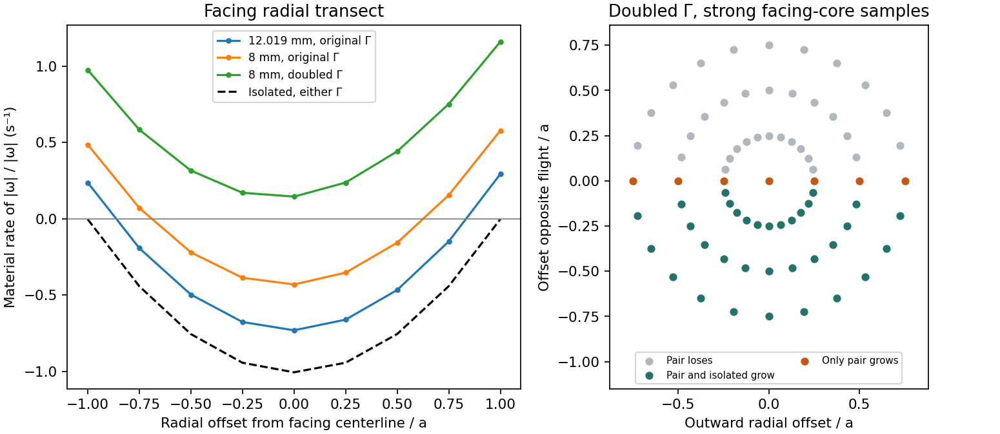

# Where in the vortex core does the water spin up?

**The 8 mm pair gains vorticity in parts of the strong core that lose vorticity in isolation.** This already occurs at the original circulation, despite a negative tendency everywhere on the geometric centerlines. Doubling circulation at the same gap extends this region to the facing centerline and the nearby maximum of vorticity in that section. Other sides of the same section lose vorticity rapidly. Neither the sign at a point nor this spatial asymmetry measures a change of core area.

## Normal sections and controls

Evaluate the left ring at 0°, 11.25°, 45°, 90° and 180° from facing. Reflections supply the equivalent arcs on the right and across the y=0 plane. At each station the first section axis is the outward radial vector of the parent circle. The second is its oriented tangent crossed with the radial vector, opposite its propagation normal. Sample r/a = 0, ¼, ½, ¾, 1, 1½ and 2 at 15° intervals, once at r = 0. Use the full summed ω, project the total gradient and vector Laplacian along ω̂, and repeat with the isolated field at the same laboratory points. Direction departs from the geometric tangent by up to 6.72° on the sampled 11.25° near shoulder of the closer pair. Values describe individual material points at release.

The strong-core screen uses |ω| ≥ 50% of the matched isolated centerline magnitude. Tails below 10% are reported separately in the point file via the continuous magnitude ratio. Counts below refer to sampled locations, with no area weighting. In the original geometry 31 of 73 strong facing samples grow, all 31 also grow in isolation. Off the symmetry plane, rotation around a curved tube moves fluid inward on one side and outward on the other. For an isolated axisymmetric no-swirl ring the azimuthal vorticity stretches at uᵣ/r. This accounts for substantial opposite signs across an isolated section. The partner can alter that rate or reverse a loss.

| Release | Facing strong samples growing only with partner | Same at 11.25° | Same at 45° / 90° / 180° |
|---|---:|---:|---:|
| Original 12.019 mm, Γ₀ |0|0|0 / 0 / 0|
| 8 mm, Γ₀ |4|3|0 / 0 / 0|
| 8 mm, 2Γ₀ |7|6|0 / 0 / 0|

The counts use the sign of the converged analytic projection. One near-shoulder reversal in the doubled case is only +0.008 s⁻¹ and would be unresolved at an experimental uncertainty of 0.02 s⁻¹. The radial facing examples below have larger margins. At the original gap there are also interaction-induced reversals nearer the edge. At one core radius radially outward, where |ω| is 34.6% of its reference, the pair gives +0.293 s⁻¹ against −0.003 s⁻¹ in isolation. At 8 mm and Γ₀ the radial shoulders at ±0.75a are stronger examples. At doubled Γ, 7 of 128 centerline azimuths per ring gain vorticity. A local search for the maximum of |ω| inside the facing section finds it 0.0665 mm radially inward. Its material tendency is +0.14157 s⁻¹ (+40.47 s⁻²), close to +0.14506 s⁻¹ at the geometric center. These numbers do not measure motion of a maximum relative to a later section.

| Facing point | Magnitude s⁻¹ | Stretch s⁻¹ | Viscous s⁻¹ | Net s⁻¹ | Net s⁻² | Isolated net s⁻¹ |
|---|---:|---:|---:|---:|---:|---:|
| Γ₀, 8 mm, outward 0.75a |77.6|0.597|−0.442|+0.155|+12.0|−0.442|
| Γ₀, 8 mm, inward 0.75a |85.7|0.513|−0.443|+0.070|+6.0|−0.443|
| 2Γ₀, 8 mm, centerline |285.5|1.152|−1.007|+0.145|+41.4|−1.007|
| 2Γ₀, 8 mm, outward 0.5a |215.3|1.197|−0.756|+0.441|+95.0|−0.756|
| 2Γ₀, 8 mm, forward 0.5a |222.4|9.791|−0.756|+9.035|+2009|+7.475|
| 2Γ₀, 8 mm, backward 0.5a |222.4|−7.407|−0.756|−8.163|−1815|−8.987|
| 2Γ₀, 8 mm, outward 2a |4.12|0.501|+2.729|+3.231|+13.3|+3.008|

Diffusion itself increases |ω| in much of the outer tail by transporting vorticity outwards. A large fractional rate there can carry little dimensional growth. The last example has only 1.44% of reference strength. [Coordinates, full local directions, dimensional and fractional budgets, and isolated controls](ring-experiment/sections.csv)

## Circulation and shape at release

Integrate signed ω·t on a disk of radius 2a in each plane, and independently integrate u·dl on its circumference. Compute the positive axial-vorticity centroid and its covariance on that disk. The two quoted widths are √(2λᵢ), where λᵢ are the covariance eigenvalues. A full straight Gaussian would give a in both directions. The finite aperture omits part of the tail and makes the reported widths smaller. Doubling Γ at fixed shape leaves both widths and normalized flux unchanged.

| Section | Flux / Γ | Minor / major widths mm | Radial centroid mm |
|---|---:|---:|---:|
| Original facing |0.98143|1.92364 / 1.92709|−0.06195|
| 8 mm facing |0.98003|1.91790 / 1.92552|−0.06634|
| 8 mm far |0.98143|1.92364 / 1.92709|−0.06195|

The 8 mm facing disk reaches the symmetry midpoint. Reduced signed flux there reflects the partner’s opposite tail in the constructed field. These are different initial fields with different apertures in space. A time history with tracked sections is essential to infer thinning. [All circulation, centroid and principal-width measurements](ring-experiment/section_shape.csv)

## Numerical checks and the cancellation point

At regular points, 128→256 and 256→512 source changes are under 8 × 10⁻¹⁴ s⁻¹ in fractional net rate. Central section samples reproduce the centerline calculation. The independent Cartesian velocity-difference projection has maximum errors 0.06769, 0.01696, 0.00425 and 0.00107 s⁻¹ at a/8, a/16, a/32 and a/64. The coarse off-axis Cartesian estimate exceeds 0.02 s⁻¹. Its fourfold error reduction and the independent difference directly along ω̂ (errors ≤0.00707 and 0.000111 s⁻¹ at the extreme steps) distinguish finite-offset bias from source error. Divergence and curl discrepancies stay below 4.1 × 10⁻¹³ s⁻¹. Doubling section integration from 8×24 to 16×48 radial Gauss/periodic angular nodes while doubling source resolution changes flux/Γ by <1.4 × 10⁻⁹ and widths by <8 × 10⁻⁹ mm. Stokes flux and loop circulation agree within 10⁻¹² Γ on the fine disks.

The initial all-point refinement failed at (x,y,z) = (0,0,−7.5) mm in both 8 mm states. Two mirror symmetries force **ω = Δω = 0** there. Raw fractional net changed by up to 1.86 s⁻¹ between fine quadratures when normalizing roundoff. The CSV retains the node with exact zero magnitude and absolute material tendency, blank direction and fractional rates. The JSON preserves raw projections at each resolution. This geometric rule excludes just one node per closer facing section. [Audit including raw nulls and finite offsets](ring-experiment/section_checks.json)

Reproduce with `python -m physics_first.ring_sections OUTPUT_DIR` and `python -m physics_first.plot_ring_sections OUTPUT_DIR OUTPUT_DIR/facing.png`. The first command also evaluates the [one-factor sensitivity cases](ring-experiment/sensitivity.csv). [Section calculation](../../physics_first/ring_sections.py) · [Figure source](../../physics_first/plot_ring_sections.py)
