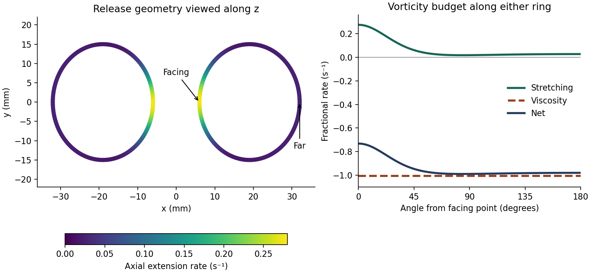

# Can the two water rings overcome diffusion at release?

**Viscosity wins at every sampled centerline point.** At the two facing points the partner supplies +0.27530 s⁻¹ of axial extension, the largest value on either ring. Viscosity contributes −1.00677 s⁻¹ there. A fluid element carrying 142.761 s⁻¹ of vorticity therefore starts losing it at **104.43 s⁻²**, compared with **143.73 s⁻²** at the corresponding point of an isolated ring. The encounter offsets 27.3% of the local diffusive loss at best. Both rings stretch at all 128 sampled azimuths each. The closest approach gives the slowest decay, while the fastest decay occurs on the flanks. [Release design and prospective checks](INTERACTING_VORTICES.md#validation-before-evolving-the-pair)



## The signed vorticity budget

All quantities refer to the instant after release. Let **w** = **ω**/|**ω**|, Jᵢⱼ = ∂uᵢ/∂xⱼ, and D = (J + Jᵀ)/2. In the constant-density, constant-ν solenoidal approximation, the material rate following the water is

```text
(1/|ω|) D|ω|/Dt = s + v
s = w · D w = w · J w          v = ν w · Δω / |ω|
```

The Laplacian acts on the **vector** ω. Multiplying the fractional rates by |ω| gives the three contributions in s⁻². Each source's strain and viscous term use the same total **w** and total |ω| at a given point. Each isolated control uses its own vorticity direction and magnitude. All numbers below use 512 source points per ring.

| Location on either ring | Angle from facing point | Self / partner stretching (s⁻¹) | Viscous (s⁻¹) | Net (s⁻¹) | Stretching / viscous / net (s⁻²) |
|---|---:|---:|---:|---:|---:|
| Facing, largest extension and least negative net | 0° | 0 / +0.27530 | −1.00677 | −0.73147 | +39.30 / −143.73 / −104.43 |
| Facing-side shoulder | 45° | 0 / +0.06028 | −1.00677 | −0.94649 | +8.61 / −143.73 / −135.12 |
| Flanks, smallest extension and most negative net | ±84.375° | 0 / +0.01737 | −1.00677 | −0.98940 | +2.48 / −143.73 / −141.25 |
| Far | 180° | 0 / +0.02697 | −1.00677 | −0.97981 | +3.85 / −143.73 / −139.88 |
| Matched isolated ring, either orientation | All | 0 / absent | −1.00677 | −1.00677 | 0 / −143.73 / −143.73 |

There is **no negative axial stretching** at the sampled locations. A solitary circular ring carries every point forward along its normal at the same centerline speed, 0.032289 m/s. Its centerline axial extension vanishes by rotational symmetry and the absence of radial or azimuthal self-velocity in its plane. The partner induces different velocities at adjacent points of an arc. At the gap the local vortex directions are opposite and parallel to the y-axis. On either side of y = 0, the induced y-velocity points away from the symmetry plane, pulling the arc lengthwise. At the facing point ∂uᵧ/∂y = +0.27530 s⁻¹. The straight-filament gradient scale of about 2 s⁻¹ in the design counts gradients in other directions too. Only the axial projection contributes to this stretching budget. The energy for the flow comes from the initial nozzle preparation.

**Geometry and direction.** For side σ = −1 (left) or +1 (right), define **e** = (cos 30°, 0, σ sin 30°). Starting at center (σ19, 0, 0) mm, add R(**e** cos θ + **eᵧ** sin θ), with R = 15 mm. Increasing θ gives the oriented tangent and a right-handed circulation about (−σ sin 30°, 0, cos 30°). Facing points are at (±6.010, 0, −7.500) mm and far points at (±31.990, 0, +7.500) mm. Left/right facing azimuths are 0°/180°. The fastest losses occur at left θ = 84.375°, 275.625° and right θ = 95.625°, 264.375°. Neighbouring samples are 2.8125° apart. These extrema describe sampled material tendencies on the specified geometric circles. Finding a continuous extremum inside a curved core would require transverse sampling as well.

The calculated direction is tangent to within 3.86 × 10⁻¹⁴ degrees throughout. We used atan2(|**w** × **t**|, **w** · **t**) so rounding a dot product to 1 cannot hide a tilt. Angle differences this small are at floating-point resolution. The facing centerlines are just over six Gaussian radii apart. The partner's Gaussian vorticity tail contributes at most 5.7 × 10⁻¹⁵ s⁻¹ to the fractional viscous rate, yet its longer-range velocity gradient supplies essentially all the stretching. The matched single-ring rate differs slightly from the straight Gaussian estimate −4ν/a² = −1.00340 s⁻¹ because the ring curves.

**Velocity and tensor example.** At the left facing point, (uₓ,uᵧ,u_z) = (12.931, 0, 19.539) mm/s. The isolated contribution is (16.144, 0, 27.963) mm/s. The partner slows the forward and inward motion there. The right facing point has the opposite uₓ. At the left facing point the total J in s⁻¹ is

```text
[ −1.57935    0         69.41718 ]
[  0          0.27530    0       ]
[−73.34347    0          1.30405 ]
```

Large off-diagonal entries include the core rotation. The signed axial entry and the negligible trace provide two distinct checks on reading this tensor. [All 256 locations, velocity vectors, tensors and budgets](ring_strain.csv)

## Gaussian Biot–Savart calculation

Use the free-space, zero-background-velocity field of two closed filaments, each with Γ = 0.0018 m²/s and a = 0.002 m. The specified 293.15 K water at 101325 Pa has reference ρ ≈ 998 kg/m³, ν = 1.0034 × 10⁻⁶ m²/s and c ≈ 1482 m/s. The circulation Reynolds number is about 1794. The release construction is **ω** = Γ ∮ Gₐ(**x** − **X**) d**X** for each loop, with Gₐ = exp(−r²/a²)/(π³ᐟ²a³). Differentiating the Gaussian gives ΔGₐ = (4r²/a⁴ − 6/a²)Gₐ. Closure makes the vorticity solenoidal because its divergence is an integral of a total derivative along the loop.

**Derivation of the velocity kernel.** Convolution replaces the unit point source in the Newtonian potential by the spherical density Gₐ. The radial flux law gives the enclosed mass M(r) = 4π ∫₀ʳ t²Gₐ(t) dt. Write **r** = **x** − **X**, q = r/a, and K = M/r³. Substituting t = rv gives a nonsingular integral valid even at a source point. Differentiating under the integral gives B = K′/r.

```text
K =  4/(√π a³) ∫₀¹ v² exp(−q²v²) dv = P(3/2,q²)/r³
B = −8/(√π a⁵) ∫₀¹ v⁴ exp(−q²v²) dv = −3 P(5/2,q²)/r⁵
u = Γ/(4π) ∮ (dX × r) K
∂ⱼu = Γ/(4π) ∮ [(dX × eⱼ) K + (dX × r) rⱼ B]
```

Here P is the normalized lower incomplete gamma function. The implementation uses the displayed integral limits K(0) = 4/(3√π a³), B(0) = −8/(5√π a⁵). At large r, M → 1 and the usual Biot–Savart law follows. K has units m⁻³, B has units m⁻⁵, u has units m/s, and J has units s⁻¹. Each element has zero velocity divergence since (**dX** × **r**) · **r** = 0 and the linear cross-product map has zero trace. Independent tests integrate the radial moments directly, check the on-axis circulation sign and speed, and evaluate the circular Gaussian vorticity and its Laplacian using modified Bessel functions. [Incomplete gamma definitions](https://dlmf.nist.gov/8.2#i) · [Calculation](../../physics_first/ring_strain.py) · [Independent tests](../../tests/test_ring_strain.py)

## Resolution and numerical uncertainty

The periodic trapezoidal rule uses exact analytic tangents weighted by R 2π/N. Targets stay at the same 128 azimuths on each ring as source resolution changes. The differences below are maximum **pointwise** changes over both rings. A smooth periodic integrand with a resolved finite core can reach roundoff quickly. These refinements show no measurable order for the remaining quadrature error.

| Source points per ring | Arc step (mm) | Min / max s (s⁻¹) | Min / max net (s⁻¹) | Max change in s / v from previous (s⁻¹) |
|---:|---:|---:|---:|---:|
| 128 | 0.7363 | +0.017373 / +0.275301 | −0.989401 / −0.731474 | — |
| 256 | 0.3682 | +0.017373 / +0.275301 | −0.989401 / −0.731474 | 9.05 × 10⁻¹⁵ / 1.33 × 10⁻¹⁵ |
| 512 | 0.1841 | +0.017373 / +0.275301 | −0.989401 / −0.731474 | 9.23 × 10⁻¹⁵ / 2.22 × 10⁻¹⁵ |

Centered differences use velocity values at displaced targets with the source loops fixed. We difference in x, y and z, assemble J, and project onto the vorticity direction at the central target. A second check differences directly along that fixed direction. The table gives maximum absolute analytic-minus-centered discrepancies in s⁻¹ at N = 512.

| Offset | Partner J, any entry | Partner axial projection | Pair J, any entry | Pair axial projection | Pair, differenced along **w** |
|---|---:|---:|---:|---:|---:|
| a/8 = 0.250 mm | 0.0007360 | 0.00007618 | 0.5530 | 0.002419 | 0.00007618 |
| a/16 = 0.125 mm | 0.0001839 | 0.00001905 | 0.1388 | 0.000605 | 0.00001905 |

Both fine-quadrature differences and both offsets pass the **0.02 s⁻¹ criterion for the specified projected rates**. The Cartesian tensor discrepancy is largest in the self-field, whose entries reach 73 s⁻¹ and vary on the 2 mm scale. Halving the offset reduces that discrepancy by a factor of 3.98, consistent with second-order differencing. The measured projected errors are small compared with the 0.73147 s⁻¹ deficit at the most favourable point.

At 512 points, max |div u| is 1.95 × 10⁻¹⁵ s⁻¹ or less, and max component discrepancy between curl u and the Gaussian ω is 2.0 × 10⁻¹³ s⁻¹. The x-reflection swaps rings at θ → π − θ and the y-reflection swaps flanks at θ → −θ. Velocity transforms as a polar vector, vorticity as an axial vector, and J by reflection on both indices. Mirrored rates differ by at most 1.28 × 10⁻¹⁴ s⁻¹. The isolated speed varies by less than 3.6 × 10⁻¹⁶ m/s, isolated stretching stays below 8.5 × 10⁻¹⁵ s⁻¹ in magnitude, and isolated viscous-rate variation is at most 2.23 × 10⁻¹⁵ s⁻¹. These checks address discretization at release. The prescribed core shape, tank environment and actual nozzle preparation carry separate physical uncertainties. [Full convergence, symmetry and gradient measurements](ring_strain.json)

## Physical interpretation and next experiment

The ring pair is a measurable source of three-dimensional extension, but this release geometry is a weak candidate for **immediate concentration**. Its best stretching would have to be about 3.66 times larger to balance the observed local diffusion at that point. Even a positive material vorticity tendency would leave core contraction unproven. That would require tracking material segment length, signed circulation, half-circulation radius and both transverse widths over time. These release data alone establish neither subsequent narrowing nor breakup, instability or singularity.

The initial swirl Mach number is about 6 × 10⁻⁵. Biot–Savart supplies the solenoidal part of a free-space, decaying velocity at leading low-Mach order. The approximation holds density and transport properties uniform and neglects acoustic velocity, dilatation, baroclinic torque, variable-coefficient viscous terms, nozzle wakes and wall or periodic images. A compressible prediction needs a balanced pressure field including the mutual interaction, an EOS-consistent density and energy, and evolution of momentum, heat and acoustic disturbances. The failed fixed-step SU2 pressure qualification and the open rotating-balance check still apply. [Water model](PHYSICAL_MODEL.md) · [Shear qualification](SHEAR_QUALIFICATION.md)

**One next experiment for review.** Change only the initial facing-centerline gap, from 12.019 mm to **8.000 mm (4a)**, as one independently prepared release geometry. Keep the same nozzles, orientation, Γ, R, a and ν, moving the model centers to x = ±(R cos 30° + 4 mm) ≈ ±16.990 mm. This tests a specific physical explanation for the deficit: the measured axial component is weak at six core radii and the gradient from the partner varies strongly across the ring. Four radii leave the nominal cores distinct. The previous release cannot be extrapolated to this gap by rigid translation during flight. For a laboratory realization, single-ring calibration and imaging would have to confirm the specified detached state and absence of substantial nozzle wakes at release.

Start with the same time-zero calculation and isolated controls on that single geometry. Retain the same convergence tests, report the signed margin at every sampled point, and stop for review even if diffusion still wins. Changing one physical distance gives a direct comparison with this baseline. Switching to bowed tubes would change the preparation, curvature and end conditions together. The present deficit does not justify starting time evolution.

## Reproduction

From the repository root, select Python with NumPy and SciPy. The recorded calculation used CPython 3.12.14, NumPy 2.5.5 and SciPy 1.17.1. The figure uses the CSV and system Matplotlib 3.10.7.

```bash
work=$(mktemp -d)
water_python="$HOME/.local/opt/water-acoustics/tools/bin/python"
export PYTHONPATH=/tmp/water-r277-scipy.MZ7N4z  # existing SciPy on daisy
export OPENBLAS_NUM_THREADS=1
"$water_python" -m physics_first.ring_strain "$work"
"$water_python" -m unittest -v tests.test_ring_strain tests.test_water_scales
cmp "$work/ring_strain.json" docs/physics-first/ring_strain.json
cmp "$work/ring_strain.csv" docs/physics-first/ring_strain.csv
env -u PYTHONPATH MPLBACKEND=Agg python3 -m physics_first.plot_ring_strain \
    "$work/ring_strain.csv" "$work/ring_strain.png"
cmp "$work/ring_strain.png" docs/physics-first/ring_strain.png
```

The calculation writes measurements even on a scientific gate failure and returns status 1 in that case. The CSV uses laboratory x,y,z for positions, velocities, unit vectors and J (row = velocity component, column = derivative direction). Prefixes `iso_` and `partner_` identify the separate fields. The scalar columns `s`, `visc`, `net` and their source projections are fractional rates in s⁻¹. The three `_abs` columns are **signed dimensional** rates in s⁻². [Figure source](../../physics_first/plot_ring_strain.py)
