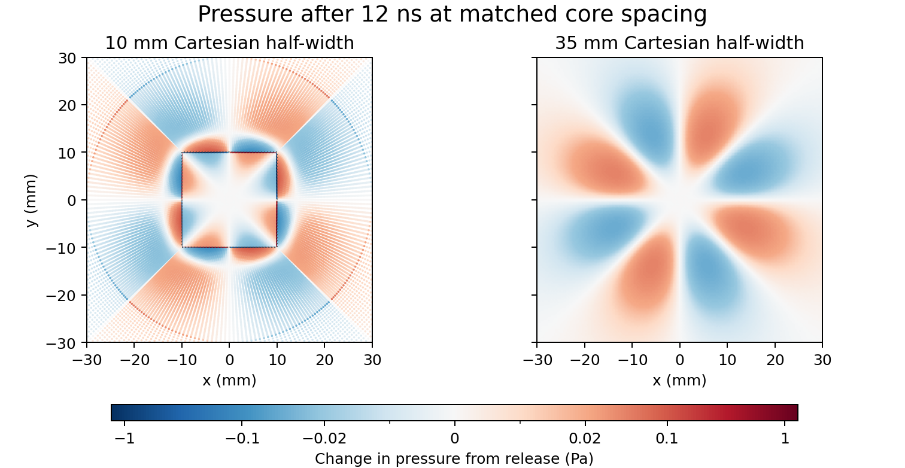

# How accurately can SU2 keep rotating water in balance?

**The release force passes on two grids. The time-dependent disk remains unqualified.** The pressure outside the vortex core must exceed the pressure at its center by 15.9053 Pa to turn the water in a circle. SU2 starts with that pressure difference and nearly the correct viscous drag. Yet very small errors in how much water crosses each cell face begin to compress the liquid. On the medium mesh a 1.29 Pa disturbance appears in just 12 ns. Its position and size depend strongly on the mesh.



## Release state and the actual solver force

The 200 mm-diameter disk has a stationary no-slip adiabatic wall, no body force and both Cartesian momenta. The 10 mm, 0.1 m/s swirl tapers to rest from 60 to 80 mm. We integrate dp/dr = ρ(p,T)uθ²/r inward from 101325 Pa at 293.15 K using the existing midpoint initializer at 128 radial intervals per peak radius. A shape-preserving cubic interpolates pressure to each SU2 solution point. A liquid (p,T) flash supplies ρ,e. The restart stores ρ, ρuₓ, ρuᵧ and ρ(e+|u|²/2). An independent (ρ,e) flash on the packed Cartesian state checks every distinct state. All nodes were liquid, wall speed was zero, maximum pressure round-trip error was 0.000255 Pa and temperature recovered within 4.4 × 10⁻¹¹ K. The heat conductivity and dynamic viscosity were held at the measured wall values, 0.598012 W/(m K) and 0.001001596 Pa s. [Mesh and initializer](../../physics_first/rotating_disk.py) · [No-slip reference](ROTATING_REFERENCE.md)

The baseline has a Cartesian central square of half-width 10 mm. Four conforming blocks join it to a 30 mm circle and graded annuli reach the wall. Each refinement doubles the number of intervals in both directions. SU2 evolves nodal values on polygonal control volumes bounded by edge midpoints and element centers. We reconstructed their areas V, checked positivity and the polygon area, then confirmed their use in the actual update. Geometry and centripetal advection enter through the Cartesian face fluxes. There is no centrifugal body-force input.

SU2's volume field `RESIDUAL` writes **LinSysRes**. A single forward-Euler evaluation at the release, on one grid level, has Q₁−Q₀ = −Δt R(Q₀)/V. The archived nodal residuals match all four updated conservative fields within storage and geometry rounding. Maximum absolute momentum-update discrepancies were 7.2 × 10⁻¹⁵ kg/(m² s). We compute the instantaneous Eulerian velocity derivative as −(Rₘ−u Rρ)/(ρV) and project it radially and tangentially. The expected radial result is zero when pressure and inward turning balance. The expected tangential result is viscous decay. RMS is weighted by dual area over 0 < r ≤ 30 mm, with the axis measured separately. The archive also gives r ≤ 10 mm and boundary/interior masks. [Measurement](../../physics_first/measure_disk.py) · [Installed output source](https://github.com/su2code/SU2/blob/7048fd35f56d4bf52e586429d6746a36a10255f8/SU2_CFD/src/output/CFlowCompOutput.cpp#L363-L370) · [Installed update](https://github.com/su2code/SU2/blob/7048fd35f56d4bf52e586429d6746a36a10255f8/SU2_CFD/include/solvers/CFVMFlowSolverBase.hpp#L877-L905)

| Cells per 10 mm | Nodes / wall faces | Recovered inner rise (Pa) | Inner radial RMS / max (m/s²) | Tangential error RMS (m/s²) | Kinetic loss rate (µW/m) |
|---|---:|---:|---:|---:|---:|
| 16 | 9,281 / 128 | 15.90547 | 0.002194 / 0.03845 | 0.000637 | 184.725 |
| 32 | 36,993 / 256 | 15.90547 | 0.000755 / 0.01929 | 0.000228 | 169.270 |
| 64 | 147,713 / 512 | 15.90547 | 0.000420 / 0.00979 | 0.000240 | 167.359 |
| 32, wider square | 165,313 / 896 | 15.90547 | 0.000256 / 0.00098 | 0.000178 | 169.173 |

The 0.05 Pa rise criterion passes. The two finer baseline grids meet the 0.001 m/s² radial RMS limit, with monotone improvement. The largest baseline radial errors are at (±10, ±10) mm. The separate peak-region RMS values are 0.001824, 0.000478 and 0.000329 m/s². The pointwise error and the small reversal in tangential RMS error on the finest grid remain relevant to point tracking. SU2's own primitive rise is 15.90543 Pa on all three. [Coarse](rotating-disk/release16.json) · [Medium](rotating-disk/release32.json) · [Fine](rotating-disk/release64.json) · [Wider square](rotating-disk/release-wide32.json)

A matched medium-grid release with half μ separates the linear stress contribution by doubling the difference of the two **solver** momentum residuals. The mass residual is bit-identical. The isolated stress gives 0.001164 m/s² tangential RMS, 0.00000924 m/s² RMS discrepancy from ν(u″+u′/r−u/r²) and only 0.00000700 m/s² radial RMS. Its integrated kinetic power is −167.001 µW/m versus −167.097 µW/m for the no-slip reference (0.058% difference). Other spatial fluxes account for most of the local radial defect and the remaining kinetic loss. This validates the release stress at this setting. [Viscosity control](rotating-disk/viscous.json) · [Matched operator difference](../../physics_first/disk_viscous_control.py)

## Short explicit evolution and detection limit

We used the historical two-stage midpoint RK and JST coefficients (0.5, 0). For each disk we bounded the summed acoustic speed using (c+0.1) times the sum of median-dual face lengths divided by area, including boundary faces. The release probe uses 0.2 divided by the maximum bound. The matched pilot uses smaller steps. The table reports independently recovered pressures at the final common time. The physical pressure-rise change expected in 12 ns is about −10⁻⁸ Pa.

| Core grid, method | Physical step × count | Peak pressure change magnitude anywhere (Pa) | Inner RMS (Pa) | Wall time / peak RSS |
|---|---:|---:|---:|---:|
| 32, midpoint | 3 ns × 4 | 1.29116 | 0.08749 | 21.55 s / 120.7 MiB |
| 32, half step | 1.5 ns × 8 | 1.29114 | 0.08749 | 37.20 s / 120.7 MiB |
| 64, midpoint | 3 ns × 4 | 0.65381 | 0.03112 | 80.34 s / 285.3 MiB |
| 32, wider square | 3 ns × 4 | 0.07822 | 0.01955 | 91.20 s / 311.1 MiB |

The medium-grid peak was already 0.646 Pa at 6 ns. At 12 ns it occurs at (5.3125, −10) mm. The square boundary carries 95.4% of inner area-integrated (Δp)², rising to 97.6% under spatial refinement. Propagating the **actual** conservative mass and energy residuals through the water EOS derivatives predicts peak pressure rates of 107.6 and 54.54 MPa/s on the medium and fine grids. Multiplying by 12 ns predicts the observed peaks to about 0.002 Pa. Continuous circumferential flow has zero mass divergence at release. Small discrete mass-flux errors matter because liquid water is stiff. Agreement under a quarter turn is exact in recovered pressure on the explicit disks, yet the square grid gives a fourfold angular pattern. [Medium, including radial profiles and inventories](rotating-disk/rk32.json) · [Half step](rotating-disk/half32.json) · [Fine](rotating-disk/rk64.json)

In one bounded mesh correction we moved the Cartesian half-width to 35 mm and the first complete circular layer to 65 mm. We held the inner Cartesian spacing, state, operator and time step fixed. The core maximum fell to **0.04456 Pa**, with the global maximum now near r = 65 mm. No sound from that junction could reach the core in 12 ns. This removes most of the startup source in the measurement region. The run covers only 0.009% of a diameter sound crossing. Settled radial balance, later reflected sound and the post-adjustment 0.05 Pa ripple gate remain unmeasured. [Corrected mesh endpoints](rotating-disk/wide32.json) · [Time cases](../../physics_first/disk_time_cases.py)

The no-slip solution predicts a 12 ns peak-speed change of −3.0 × 10⁻¹¹ m/s and peak-radius change of +3.0 × 10⁻¹² m. On the wider grid, quadratic peak fits to the axial and diagonal cuts differ in their **changes** by 1.34 × 10⁻¹⁰ m/s and 8.89 × 10⁻¹² m. Both exceed the signals. On the fine baseline the release peak-radius fits on those cuts differ by 0.53 µm, already twice the 1 ms physical migration. Absolute cell-circulation vorticity RMS error falls from 0.00157 to 0.000392 s⁻¹ with spatial refinement. The RMS error in its 12 ns *change* is 6.64 × 10⁻⁷ s⁻¹ on the fine baseline. These observed spreads set empirical lower bounds on uncertainty. A time-resolved diffusion fit or a 1 ms detection threshold would require longer data. [Endpoint diagnostics and fit definitions](../../physics_first/disk_pilot.py)

Kinetic loss at 12 ns was 2.070 pJ/m on the medium grid and 2.013 pJ/m on the fine grid, against 2.005 pJ/m from the initial reference power. Fine-grid mass and momentum changes were below 4.6 × 10⁻¹⁸ kg/m and 2.6 × 10⁻²⁰ kg/s per component. A stationary wall can exchange momentum. The fine total-energy defect of 0.338 pJ/m is 17% of the kinetic loss. Halving the medium step changes its defect from 1.09 to 2.31 pJ/m. These are nodal differences integrated before summation. The predicted internal-energy rise is too small to budget reliably. Equal pressure rise at the axis and 30 mm also misses pressure variations in between.

**Resource stop.** Daisy had 7.6 GiB RAM, 5.2 GiB available and zero swap in use at preflight. Release probes took 1.87, 6.10 and 23.29 s at 107, 122 and 286 MiB RSS. SU2 measured 4.48 and 17.01 compute seconds per midpoint step on the two qualifying meshes. Even using their larger screened steps of 6.73 and 3.33 ns, 1 ms projects to **7.7 and 59 days** on this serial binary, before independent step halving. The wider disk costs 19.34 s/step. No 1 ms transient, long-time diffusion, vortex heating or later contraction can be inferred from these pilots.

## Reproduce

Use SU2 8.6.0 at source `7048fd35` with CoolProp 7.2.0, binary SHA-256 `0941113d648fbd79bd745ef68f050f982225c479e3ca0f59ad28d582c28d84aa`. Use the daisy water interpreter with the R277 SciPy directory and one BLAS thread. The archive contains the original inputs' conservative states, all analysis fields in native node order, configs, histories, stdout and measured resources. The replay restores the measured doubles losslessly. Geometry regenerates from the recorded grid identifier. [Field archive](rotating-disk/fields.zip) · [Archive reader](../../physics_first/disk_archive.py) · [Environment](SU2_WATER_SETUP.md)

```bash
export OPENBLAS_NUM_THREADS=1 PYTHONPATH=/tmp/water-r277-scipy.MZ7N4z
wp="$HOME/.local/opt/water-acoustics/tools/bin/python"
base=docs/physics-first/rotating-disk
work=$(mktemp -d)
"$wp" -m physics_first.disk_archive unpack "$base/fields.zip" "$work/replay"
"$wp" -m physics_first.measure_disk "$work/replay/r289-disk32"
"$wp" -m physics_first.disk_pilot "$work/replay" rk32
"$wp" -m physics_first.disk_viscous_control measure "$work/replay/r289-disk32" "$work/replay/r289-halfmu"
"$wp" -m physics_first.plot_disk_pressure extract "$work/replay" "$work/map.npz"
env -u PYTHONPATH MPLBACKEND=Agg python3 -m physics_first.plot_disk_pressure plot "$work/map.npz" "$work/map.png"
```

To regenerate baseline inputs in a fresh directory use `python -m physics_first.rotating_disk ROOT/r289-disk32 32` (likewise 16 and 64). For the wide control use `ROOT/r289-wide32 32 --wide`. Run `su2-water wave.cfg` in each generated directory. Use `python -m physics_first.disk_time_cases ROOT rk32` to generate a pilot and run it there. Case names in the module select space, time, mesh or implicit comparisons. Daisy also retains the complete native meshes, restarts and logs in `~/.local/opt/water-acoustics/runs/r289/`. [Native file checksums](rotating-disk/native_sha256.txt)

The scientific limitations are reported in the measurements. The measurement commands exit successfully on valid extraction, including extraction of a failed solver qualification.
