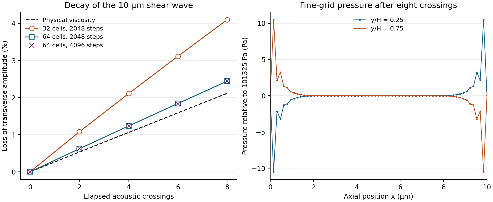

# How fast does transverse momentum diffuse in water?

**R284 failed the viscosity qualification.** In 53.97 ns, physical shear viscosity should reduce a 10 µm sine wave by 2.115%. SU2 lost 4.100% on the 32-cell grid and 2.443% on the 64-cell grid. The fine-grid effective kinematic viscosity was **1.16034 × 10⁻⁶ m²/s**, 15.64% above the material value of 1.00340 × 10⁻⁶ m²/s. Halving the step reproduced that excess. Physical diffusion accounts for most of the fine-grid damping, but the numerical contribution exceeds the 10% accuracy target. On the coarse grid the excess is almost as large as the physical viscosity. [Measurements at all endpoints](shear_results.json)



## What was measured

Neighbouring layers initially slide past one another with transverse velocity v = 0.01 sin(kx) m/s and zero longitudinal velocity. Viscous stress transports transverse momentum across layers. The linear solution is v(x,t) = A₀ exp(−νk²t) sin(kx), where k = 2π/λ and ν = μ/ρ. We used the installed SU2 8.6.0 / CoolProp 7.2.0 solver, its original centered JST flux (second/fourth dissipation coefficients 0.5/0.02), Green–Gauss gradients and explicit two-stage midpoint update. The unforced compressible Navier–Stokes equations evolve density, both momenta and total energy. The initial state has uniform p = 101325 Pa, T = 293.15 K, ρ = 998.20715 kg/m³ and ρE = ρ(e + v²/2). The run uses μ = 1.001596 mPa s and conductivity 0.598012 W/(m K). [Physical model](PHYSICAL_MODEL.md) · [Qualified solver build](SU2_WATER_SETUP.md)

The box measures 10 × 1.25 µm with four cells across its height. SU2 matched both translated pairs at zero distance. Both copies of each periodic edge had identical conservative variables at every saved time. With c = 1482.346 m/s, eight crossings take 53.9685 ns. The axial acoustic Courant numbers were 0.125, 0.25 and 0.125 in table order. The history confirms every requested physical step. [Meshes, configurations, histories, solver logs and 15 binary states](shear_snapshots.tar.gz)

| Axial cells | Steps | Step (ps) | Initial → final amplitude (mm/s) | ν fit (10⁻⁶ m²/s) | Excess (10⁻⁶ m²/s) | Interval spread / physical ν |
|---:|---:|---:|---:|---:|---:|---:|
| 32 | 2048 | 26.352 | 10.00000 → 9.59003 | 1.961786 | +0.958391 | 12.03% |
| 64 | 2048 | 26.352 | 10.00000 → 9.75570 | 1.160337 | +0.156942 | 2.061% |
| 64 | 4096 | 13.176 | 10.00000 → 9.75570 | 1.160337 | +0.156942 | 2.061% |

We measured A = 2|⟨v exp(−ikx)⟩| using dual-volume fractions, including half weights on either periodic edge and quarter weights at corners. We fitted a line with free intercept to log[A(t)/A(0)] at 0, 2, 4, 6 and 8 crossings. Its negative slope divided by k² gives ν fit. The fine half-step equivalent dynamic viscosity ρν fit is **1.15826 mPa s**. The excess is the net error of this mode on this mesh and flux. The three runs cannot partition it among artificial dissipation, viscous discretization and mode distortion. [Analysis](../../physics_first/measure_shear.py)

| Acceptance check | Change as % of physical ν | Target | Outcome |
|---|---:|---:|---|
| Fine half-step fit versus material | 15.641% | ≤10% | Fail |
| 32 → 64 cells at fixed step | 79.874% | <5% | Fail |
| Half step at fixed 64 cells | 0.000000854% | <5% | Pass |
| Largest minus smallest adjacent-interval fit | 12.030% coarse, 2.061% on both fine cases | <5% | Fail coarse, pass fine |

The independent slope of log kinetic energy (divided by −2k²) gave 1.93286 and 1.15532 × 10⁻⁶ m²/s on the coarse and fine grids. A separate projection of SU2's saved last-stage momentum and density residuals gave instantaneous fine half-step estimates of 1.1521–1.1639 × 10⁻⁶ m²/s at the four endpoints. Both diagnostics confirm excess damping. Energy includes motion outside the initial mode. By the final fine snapshot the RMS transverse velocity left after subtracting the fitted sine was 0.101 mm/s. Two axial resolutions establish sensitivity only. [Input specification and original thresholds](VORTEX_EQUILIBRIUM.md#recommended-next-experiment)

## Pressure, heating and conservation

For a periodic closed box the physical loss of kinetic energy should produce about 0.001045 J/m³ of mean internal energy. To leading order, dividing by ρcᵥ gives **0.252 nK** mean heating. At fixed mean density this corresponds to about **0.000113 Pa** through (∂p/∂T)ρ. The fine half-step mean rose 0.290 nK and 0.000135 Pa relative to its recovered initial state. These box means are broadly consistent with conversion of the measured kinetic loss, including numerical damping. Pressure recovery at time zero already has a uniform −0.0000358 Pa offset.

The spatial fluctuations were much larger. Peak absolute deviations below are relative to prescribed p and T. The four saved endpoints sample the evolution and give lower bounds on the largest excursions during the run.

| Axial cells / steps | Max pressure deviation (Pa) | Max spatial pressure RMS (Pa) | Max temperature deviation (µK) | Max longitudinal speed (µm/s) |
|---|---:|---:|---:|---:|
| 32 / 2048 | 30.17 | 5.44 | 6.81 | 39.42 |
| 64 / 2048 | 11.98 | 1.62 | 2.69 | 27.37 |
| 64 / 4096 | 11.98 | 1.62 | 2.69 | 27.37 |

Viscous heating can vary along x because the shear varies there. Translation symmetry requires the physical solution to stay uniform along y. On the fine half-step grid the pressure difference across y reached **23.95 Pa at a single x**. The extrema lay one axial cell inside the periodic seam. At the final time the two quarter-height rows still differed by 20.99 Pa there. Reconstructing p and T directly from the conservative state agreed with SU2's saved primitives to within 0.000175 Pa and 2.55 × 10⁻¹¹ K across all cases. The symmetry breaking is numerical. Its precise source in the spatial operator remains open.

Across all saved times the greatest domain-mean drifts from initialization were **2.06 × 10⁻¹³ kg/m³** in density, **2.754 × 10⁻¹⁵ kg/(m² s)** in vector momentum magnitude and **2.35 × 10⁻⁸ J/m³** in total energy. These are 2.06, 2.76 and 2.80 × 10⁻¹⁶ of ρ₀, ρ₀A₀ and initial energy density respectively. Opposite periodic boundaries cancel in the global balance. We differenced nodal states before accumulating their dual-volume averages in extended precision. Subtracting e₀ times mass drift leaves at most 3.30 × 10⁻⁸ J/m³ of energy drift, about 0.0032% of the predicted kinetic loss. Sparse residuals allow endpoint rate checks only. The conservation figures measure stored inventories.

A double-precision spacing in background ρE is 1.49 × 10⁻⁸ J/m³. The spacing at 0.01 m/s is 1.73 × 10⁻¹⁸ m/s against a predicted amplitude loss of 2.12 × 10⁻⁴ m/s. Velocity storage easily resolves the decay. The mesh dependence, distorted mode and y-dependent pressure set the accuracy limit here.

## Decision for vortex concentration

**Next, translate the initial sine by λ/4 and repeat only the 64-cell, 2048-step case.** Translation is an exact symmetry of this periodic problem. Compare the translated fields with the archived solution shifted by 16 cells. A pressure extremum that stays at the mesh seam while the wave moves would locate a mesh-dependent error. A peak that follows the wave would change that diagnosis. Compare both fields, ν fit and residuals with the existing material and interval limits. Stop after this one control for a spatial-method decision.

The installed solver is a credible candidate for that short diagnostic. Its present configuration lacks the shear accuracy and pressure balance needed to infer vortex concentration. For a 10 mm Gaussian core, stretching must beat viscous spreading at roughly 0.05 s⁻¹. Excess diffusion would bias that threshold. A vortex also has curvature, many wavelengths, a radial pressure balance and different mesh spacings. Even perfect agreement at 10 µm would leave transfer to the vortex mesh untested. R283's finest recovered-pressure refinement check still fails, and SU2's radial residual remains unmeasured. [Stretching reference](README.md#reference-a--a-vortex-left-alone) · [R283 force balance and cost](VORTEX_EQUILIBRIUM.md)

Explicit stepping is sufficient for the proposed 54 ns translation control. A practical seconds-long comparison at vortex scales needs an acoustic-implicit or time-accurate all-speed approach, low-Mach spatial accuracy, and measured convergence in physical step and inner-solve tolerance. R283 estimated about 190 million explicit steps for five seconds at its finest spacing. The half-step result here gives no evidence that changing the integrator alone would correct the excess damping.

## Reproduction

From the repository root, remeasure the archived states without another CFD run. The measurement writes JSON and exits **1** with the failed scientific criteria. The following commands check both the exit and the result. The installed solver SHA-256 on daisy was `0941113d648fbd79bd745ef68f050f982225c479e3ca0f59ad28d582c28d84aa`. The analysis used Python 3.12.14, NumPy 2.5.5 and CoolProp 7.2.0. System Matplotlib generated the plot.

```bash
water_python="$HOME/.local/opt/water-acoustics/tools/bin/python"
report=docs/physics-first
replay=$(mktemp -d)
tar -xzf "$report/shear_snapshots.tar.gz" -C "$replay"
status=0
"$water_python" -m physics_first.measure_shear "$replay" > "$replay/results.json" || status=$?
test "$status" -eq 1 && cmp "$replay/results.json" "$report/shear_results.json"
MPLBACKEND=Agg python3 -m physics_first.plot_shear "$replay/results.json" "$replay/decay.png"
"$water_python" -m unittest -v tests.test_water_shear tests.test_water_acoustics
```

To regenerate inputs and run the three cases in a fresh directory with the qualified executable, use the commands below. On daisy the original directories are under `~/.local/opt/water-acoustics/runs/r284`. Each contains one initial state and four restart outputs. [Case generator](../../physics_first/su2_shear.py) · [Checks](../../tests/test_water_shear.py)

```bash
fresh=$(mktemp -d)
"$water_python" -m physics_first.su2_shear "$fresh"
for case_dir in "$fresh"/n*-t*; do
    (cd "$case_dir" && su2-water wave.cfg > solver.log 2>&1) || break
done
```
