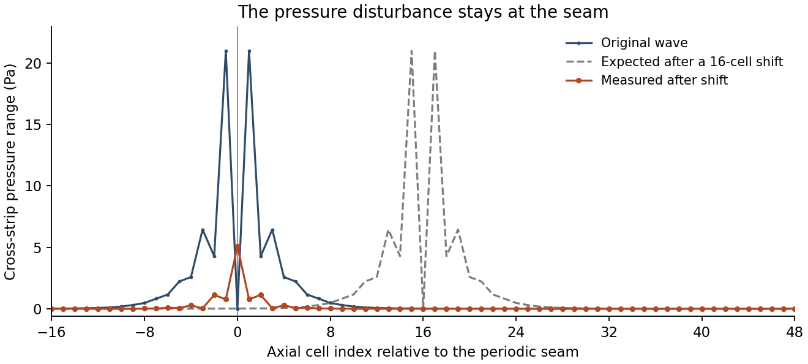

# R285 · Does the shear-wave pressure error move with the water?

**The pressure disturbance stayed at the periodic seam.** Moving the initial wave 16 cells to the right reduced the largest measured cross-strip pressure difference from **23.954 to 5.123 Pa**. At all four output times the original peaks lay one cell from the seam and the translated peak lay directly on it. In a uniform periodic box this shift should translate the entire solution by exactly 16 cells. The result identifies a spatial error and makes the fourth-order artificial dissipation at the periodic corners a specific candidate for a correction test. [Original failed qualification](SHEAR_DECAY.md) · [Measurements](shear_translation.json)



## Preflight

We used the archived 64 × 4 mesh, 2048 steps and the same SU2 8.6.0 executable (SHA-256 `0941113d648fbd79bd745ef68f050f982225c479e3ca0f59ad28d582c28d84aa`). The configuration and mesh matched the archive byte-for-byte. The initial ρ, ρu, ρv and ρE at index i came from the original (i−16) mod 64. Undoing the shift gave bit-identical fields. Both copies of each cut and all four corner values agreed. All rows had the same transverse wave, zero longitudinal velocity and total energy including local kinetic energy. Recovered pressure and temperature were spatially uniform, with the same −0.0000358 Pa pressure offset as R284.

Checking the mesh connectivity and edge orientation yielded five unique left/right donor pairs and 65 bottom/top pairs, with pure translations and opposite normals. SU2 reported zero matching distance in both runs. The four corner IDs (0, 64, 260, 324) describe one periodic vertex. Their four quarter-cell areas sum to 4.8828125 × 10⁻¹⁴ m², equal to the merged area at every one of the 256 independent vertices. The installed source accumulates periodic volume and residual by successive marker pairs, so the second volume exchange includes the first pair's contribution. These checks found no input, donor or initial-energy correction. [Audit and generator](../../physics_first/shear_translation.py) · [SU2 volume and residual exchange](https://github.com/su2code/SU2/blob/7048fd35f56d4bf52e586429d6746a36a10255f8/SU2_CFD/src/solvers/CSolver.cpp#L560-L603)

## Translation and damping

The table uses reconstructed pressure and figures from the four saved times after initialization. The symmetry observable is the pressure range over y at each fixed x. Physical viscous heating can vary with x and time, while translation symmetry in y requires this range to vanish.

| Acoustic crossings | Original peak range (Pa) | Translated peak range (Pa) | RMS pressure mismatch after undoing shift (Pa) |
|---:|---:|---:|---:|
| 0 | 0 | 0 | 0 |
| 2 | 23.954 | 5.123 | 1.638 |
| 4 | 22.471 | 5.120 | 1.538 |
| 6 | 21.610 | 5.104 | 1.480 |
| 8 | 20.994 | 5.083 | 1.438 |

Pressure extrema relative to 101325 Pa reached −11.977/+11.977 Pa originally and −2.561/+2.561 Pa after translation. For each x we subtracted its mean over y and summed the squared deviations. In the shifted case approximately **99.92%** of that signal lay within four cells of the seam at every sampled time. Less than **0.00017%** lay within four cells of index 16, where a translated copy of the original seam feature would lie. Agreement between reconstructed pressure and SU2 output was within 0.00027 Pa. The remaining 5 Pa cross-strip range is well resolved. Maximum longitudinal speed fell from 27.37 to 2.995 µm/s.

For the field comparison we discarded the two duplicated outer lines and rolled the 64 independent shifted columns back by 16. The table gives RMS differences on the 256 equal-volume vertices. The JSON also includes maximum absolute differences for every field and time.

| Crossings | Δρ (kg/m³) | Δ(ρu) (kg/m²/s) | Δ(ρv) (kg/m²/s) | Δ(ρE) (J/m³) |
|---:|---:|---:|---:|---:|
| 0 | 0 | 0 | 0 | 0 |
| 2 | 8.26 × 10⁻⁷ | 0.003880 | 0.05159 | 1.570 |
| 4 | 7.76 × 10⁻⁷ | 0.003620 | 0.07318 | 1.469 |
| 6 | 7.46 × 10⁻⁷ | 0.003475 | 0.08902 | 1.412 |
| 8 | 7.25 × 10⁻⁷ | 0.003373 | 0.10180 | 1.372 |

The Fourier fit to the same five times gave **1.050868 × 10⁻⁶ m²/s** after translation, versus **1.160337 × 10⁻⁶ m²/s** originally. Those are 4.73% and 15.64% above material viscosity. Changing only phase altered the estimate by 10.91% of material viscosity. The translated interval-fit spread was 0.000674% versus 2.061% originally. The kinetic-energy fit gave 1.050866 × 10⁻⁶ m²/s for the shifted wave. One favourable phase passes the individual viscosity and interval limits. R284's failed qualification stands, including its fixed-step grid change of 79.87%.

The signed last-stage momentum residuals also failed to translate. At eight crossings the RMS x/y residuals were (3.23 × 10⁻¹⁰, 1.61 × 10⁻⁷) N/m originally and (1.25 × 10⁻¹¹, 1.40 × 10⁻⁷) N/m after translation. Their **aligned RMS differences** were (3.23 × 10⁻¹⁰, 5.12 × 10⁻⁸) N/m, per unit out-of-plane depth. The residual-derived instantaneous modal viscosity ranged from 1.1521 to 1.1639 × 10⁻⁶ m²/s originally and 1.050871 to 1.050874 × 10⁻⁶ m²/s after translation. These are total assembled residuals at four endpoints. The initial restart contains no stage residual. [Aligned residuals and component maxima](shear_translation.json)

## What the corner stencil explains

The installed JST flux uses the difference between neighbouring undivided Laplacians to supply fourth-order artificial dissipation. SU2 first sums differences with locally connected neighbours. For the periodic correction it excludes any donor neighbour flagged as periodic. At a corner of this mesh **both** local neighbours lie on a periodic edge. Each corner copy therefore retains a one-sided axial contribution for a y-uniform shear wave. The same periodic flag also affects the neighbour counts used to scale JST dissipation. Correct pairing of coordinates and matching conservative values can coexist with a different stencil at that location. [Local Laplacian](https://github.com/su2code/SU2/blob/7048fd35f56d4bf52e586429d6746a36a10255f8/SU2_CFD/src/solvers/CEulerSolver.cpp#L2384-L2423) · [Periodic correction](https://github.com/su2code/SU2/blob/7048fd35f56d4bf52e586429d6746a36a10255f8/SU2_CFD/src/solvers/CSolver.cpp#L684-L735) · [JST flux](https://github.com/su2code/SU2/blob/7048fd35f56d4bf52e586429d6746a36a10255f8/SU2_CFD/include/numerics_simd/flow/convection/centered.hpp#L243-L261)

Evaluating that source stencil on the actual initial transverse momentum gives **+0.9784 and −0.9784 kg/(m² s)** at the original left and right corner copies. The complete four-neighbour stencil gives zero to roundoff. After translation a velocity extremum sits at the seam, where the physical shear gradient vanishes initially. Both one-sided values become **+0.04807**, versus **+0.09613** for the full stencil. This reconstruction identifies a specific phase-sensitive error before time stepping. Its location and smaller magnitude in the shifted case agree with the pressure observations. The stored outputs do not separate JST flux, viscous stress and their subsequent pressure response. The fraction of leakage due to each remains unknown.

## Decision for review

**Test one configuration correction for this smooth wave:** set `JST_SENSOR_COEFF= (0.5, 0.0)` to remove the fourth-order artificial dissipation. Keep the second-order pressure sensor, physical viscosity, heat conduction, EOS and step fixed. This change directly removes the term using the suspect Laplacian. The evidence warrants a test before changing solvers. Moving the wave to a more favourable phase leaves a multi-pascal error. [Installed option and defaults](https://github.com/su2code/SU2/blob/7048fd35f56d4bf52e586429d6746a36a10255f8/config_template.cfg#L1715)

After review, test only the two phases at 64 cells and 2048 steps. At all four saved times require the peak cross-strip range and the inverse-shifted pressure mismatch (maximum absolute) each to be ≤0.001 Pa, a prospective diagnostic tolerance above the observed EOS recovery differences. Check finite liquid states, conservation, residuals and alternating-cell oscillations because the change removes damping of short wavelengths. Retain the 10% viscosity and <5% interval limits for each phase and require their fitted viscosities to differ by <5% of physical ν. Stop if the control fails and reconsider the spatial method. Passing this screen would warrant the original independent grid/step qualification before considering vortex evolution. Continue in this chat after review. GPT-6.2 Astra at high reasoning is sufficient for the two-phase control.

## Reproduce without running CFD

The translated [archive](shear_translation_run.tar.gz) contains the configuration, mesh, initial state, four outputs, solver log and step history. Extract both archives into a fresh directory. The comparison uses the 2048-step R284 run.

```bash
water_python="$HOME/.local/opt/water-acoustics/tools/bin/python"
report=docs/physics-first
work=$(mktemp -d)
tar -xzf "$report/shear_snapshots.tar.gz" -C "$work" n64-t2048
tar -xzf "$report/shear_translation_run.tar.gz" -C "$work"
"$water_python" -m physics_first.shear_translation compare "$work/n64-t2048" "$work/translated" > "$work/check.json"
cmp "$work/check.json" "$report/shear_translation.json"
MPLBACKEND=Agg python3 -m physics_first.plot_shear_translation "$work/check.json" "$work/plot.png"
"$water_python" -m unittest -v tests.test_water_shear tests.test_water_acoustics
```

To reproduce the inputs, use `prepare` in place of `compare` with a fresh destination. It creates and verifies exactly one translated case. On daisy the calculation used `su2-water wave.cfg` from that directory, with the [R284 build and environment](SU2_WATER_SETUP.md). Scientific round R285 is request-log entry R286. The earlier R285 log entry records publication authorization.
