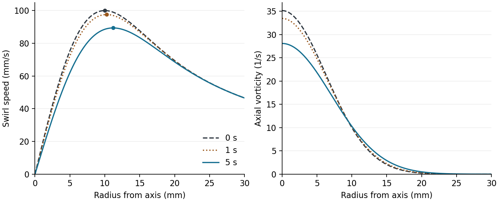

# Five seconds of unforced viscous spreading

**The finite-cylinder reference passes the predeclared checks.** The radius of fastest swirl grew from 10.000 to 11.186 mm. The water at the peak slowed by 10.6%, and the pressure rise from the axis to 30 mm fell by 3.41 Pa. Viscosity moved rotation outward while the cylinder retained its angular momentum. The peak position describes a velocity profile. It does not track a ring of water parcels. [Original decision gate](README.md#round-two-test) · [Numerical results](spreading_results.json)

| Time (s) | Peak radius (mm) | Peak swirl (m/s) | Axial vorticity on axis (s⁻¹) | p(30 mm) − p(0) (Pa) | Circulation at 10 mm (m²/s) | Kinetic energy (J/m) |
|---:|---:|---:|---:|---:|---:|---:|
| 0 | 10.000 | 0.10000 | 35.129 | 15.902 | 0.0062832 | 0.01206842 |
| 1 | 10.248 | 0.09758 | 33.448 | 15.089 | 0.0061282 | 0.01190602 |
| 5 | 11.186 | 0.08940 | 28.074 | 12.491 | 0.0055655 | 0.01132635 |



At 10 mm the circulation fell by 11.4%. At 30 mm it fell by only 0.011%, from 0.00878349 to 0.00878255 m²/s. Most of the rotation was still inside the larger circle. At 5 s the infinite Lamb–Oseen prediction was 11.18609 mm and 12.49096 Pa over the same pressure interval. The finite calculation agrees to these displayed digits. The taper starts at 60 mm and the viscous diffusion length √(4νt) is only 4.47 mm after 5 s. This separation explains the close inner agreement despite different outer velocities and total energy.

## What was calculated

The column is axially periodic over 0.10 m, with a stationary, impermeable, shear-free wall at 0.10 m radius. The initial Lamb–Oseen swirl has the specified C² taper between 60 and 80 mm. Density is 998 kg/m³, kinematic viscosity is 10⁻⁶ m²/s and the reference temperature is 293.15 K. Pressure is recovered from dp/dr = ρuθ²/r. Only pressure differences matter for this incompressible solution. The initial wall pressure of 101325 Pa absolute cancels from the reported differences.

We projected the initial velocity onto rigid rotation and 32, 64 or 128 decaying radial modes. For root λ of J₂ and k = λ/L the velocity basis is J₁(kr), its axial vorticity is kJ₀(kr), and its shear ∂ruθ−uθ/r is −kJ₂(kr). The last identity gives zero tangential wall stress. Each coefficient decays by exp(−νk²t). The projection uses weight r dr and norm L²J₁(λ)²/2. The rigid term Ωr has norm L⁴/4 for the basis r and constant Ω = 0.13517 s⁻¹. Each snapshot brackets the largest speed on a radial scan and solves for its derivative zero inside the bracket. [Calculation](../../physics_first/cylinder_spreading.py) · [NIST Bessel recurrences](https://dlmf.nist.gov/10.6) · [NIST Bessel integrals](https://dlmf.nist.gov/10.22)

The finite profiles were compared on 301 radii from the axis to 30 mm with infinite-column velocity and vorticity. Pressure was integrated separately at 10, 20 and 30 mm in both solutions. The largest sampled initial speed reconstruction errors **over the entire cylinder** were 1.70×10⁻⁵, 2.06×10⁻⁶ and 2.73×10⁻⁷ m/s for 32, 64 and 128 modes. In the inner region the finest initial speed and vorticity errors were 3.43×10⁻⁹ m/s and 1.49×10⁻⁵ s⁻¹. At 5 s they were below 10⁻¹⁵ m/s and 2×10⁻¹⁴ s⁻¹ on that sample. The early-time finite-mode error is more informative than the near-roundoff final agreement.

## Conservation and refinement

There is no wall work, mass flux or wall torque. The mass of one period is 3.13531 kg and the net vector momentum is zero by symmetry. Per metre of length the axial angular momentum stayed at 0.02119054 kg m/s, with maximum relative drift 3.44×10⁻¹⁵ across 201 stored quadrature times (limit 10⁻⁶). The kinetic-energy loss was 0.00074207056 J/m, or **6.15%**. Independently integrating the squared shear in space and time gave 0.00074207073 J/m. The difference is 1.65×10⁻¹⁰ J/m, **0.0000223% of the loss**, below the 0.5% limit. Both integrals use the reconstructed fields. Over the full 0.10 m axial period the dissipated energy is about 74.2 μJ. This mechanical benchmark does not evolve temperature or predict a thermal signal.

We varied one parameter at a time, fixing the other two at 128 modes, 2048 radial quadrature points and 0.025 s time spacing. Radial integration used eight-point Gauss panels and time integration of dissipation used the composite trapezoid rule. Time spacing has no effect on snapshot velocities because each mode has an exact time factor.

| Refinement series | Final-pair max change in peak radius (mm) | Final-pair max change in inner Δp at 30 mm (Pa) | Change in integrated dissipation (% of loss) | Change in energy residual (% of loss) |
|---|---:|---:|---:|---:|
| Modes 32, 64, 128 | 0.000392 | 0.0000472 | 3.67×10⁻⁷ | 2.87×10⁻⁹ |
| Radial points 512, 1024, 2048 | 2.29×10⁻⁹ | 1.13×10⁻¹⁰ | 4.53×10⁻⁹ | 2.69×10⁻¹² |
| Dissipation spacing 0.100, 0.050, 0.025 s | 0 | 0 | 0.0000667 | 0.0000667 |
| Decision limit | 0.02 | 0.05 | 0.5 | 0.5 |

Radius and pressure changes are maxima over 0, 1 and 5 s. The five-second peak is 0.00391 mm from the rounded 11.19 mm target (limit 0.05 mm). The 0.100, 0.050 and 0.025 s energy residuals decrease by about fourfold per halving. This checks the time integral independently of the mode and radial refinements. Reported differences establish numerical resolution for this smooth benchmark. A no-slip tank, a longer experiment or three-dimensional stretching would give different dynamics.

## Reproduction and next decision

Run from the repository root with NumPy 2 or newer and SciPy. The figure additionally uses Matplotlib.

```bash
OPENBLAS_NUM_THREADS=1 python -m physics_first.cylinder_spreading
python -m unittest -v tests.test_cylinder_spreading tests.test_water_scales
python -m unittest discover -v -s tests/realizability -p test_b0.py
MPLBACKEND=Agg OPENBLAS_NUM_THREADS=1 python -m physics_first.plot_spreading spreading_profiles.png
```

The saved JSON came from project Python 3.12.14, NumPy 2.5.3 and a SciPy 1.17.1 wheel in an isolated temporary directory. The system Python 3.14.4, NumPy 2.3.5 and SciPy 1.16.3 independently reproduced the gate decisions and peak/energy observables with the same algorithm. The 3 mode/input tests, 4 scale tests and 8 B0 tests passed. The plot used system Matplotlib 3.10.7. Archived FEM, rendering, compressible-liquid and three-dimensional runs were outside this round.

**Next proposed test.** Can an accessible conservative liquid-water solver propagate a 10 Pa pressure wave accurately enough to trust pressure differences of this size? Use the planned 0.10 m periodic line, actual EOS sound speed and the pressure amplitude/phase and conservation checks. Stop with the qualification result or a specific solver/EOS access gap. The vortex comparison comes after qualification. [Acoustic test specification](README.md#physical-test-after-the-reference)
