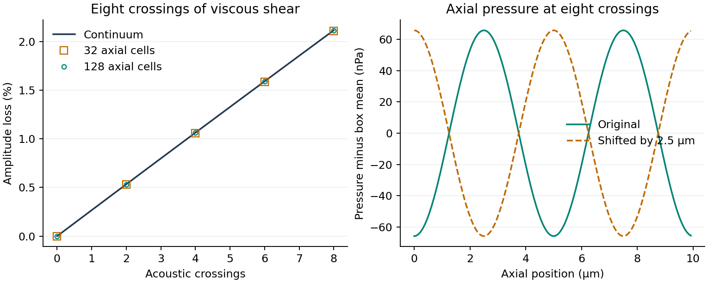

# Transverse momentum diffusion in two-dimensional liquid water

**R294 passes the periodic shear benchmark.** On the 128 × 4 strip the transverse velocity amplitude fell **2.114715%** in eight acoustic crossings. The continuum prediction is **2.115135%**. At the physical step where both archived SU2 phases broke transverse pressure symmetry, the new solver's independently recovered pressure had zero measured cross-strip range and zero difference after undoing the quarter-wave shift. The largest viscosity error on any of the three grids was 0.321%. This qualifies a short rotating-disk comparison after review. The accuracy of the pressure force and its curl near a curved wall remains open. [Fields, measurements and replay](r294/REPLAY.md) · [Historical shear qualification](SHEAR_QUALIFICATION.md)



## From a pressure step on a line to two momentum equations

Mass and shifted total energy occupy Cartesian cells. The two Cartesian momentum densities occupy the corresponding positive x and y faces, each with its own full-area dual volume centered on that face. Periodic indexing gives precisely Nx × Ny samples of each quantity. Cell centers lie at x = iΔx and y = jΔy, matching the original axial sampling. A face normal to y has the same x as its cell. The translated release rolls every conserved field by exactly Nx/4. The entire 2D array, including every transverse row and every Fourier mode, evolves freely.

Let B denote an arithmetic mean to the next location and D the signed flux difference divided by cell width. Face density is ρ₀ + B(ρ−ρ₀), face velocity is momentum divided by that density, and cell kinetic energy density K is the sum of the averages of mᵢuᵢ/2 from each opposing pair of faces. This assigns each face kinetic energy to its two neighbors and reproduces the integrated dual-volume kinetic energy. Store r = ρ−ρ₀ and H = ρ(E−e₀). The EOS inputs are r and e−e₀ = (H−K)/ρ. The solver uses R293's midpoint integration of Helmholtz water derivatives, including the physical density derivative, and its ambient pressure, energy and transport references. Constant p₀ cancels from periodic momentum differences and is retained in the shifted enthalpy hₛ = e−e₀ + (p₀+π)/ρ. [R293 formulation and EOS precision](LIQUID_IMEX.md) · [2D implementation](../../physics_first/liquid_imex_2d.py)

The normal stresses are at cell centers and the symmetric shear stress is at cell corners. For planar flow of the three-dimensional liquid with zero added bulk viscosity, dilatation is θ = ∂ₓu + ∂ᵧv. We use τₓₓ = 2μ(∂ₓu−θ/3), τᵧᵧ = 2μ(∂ᵧv−θ/3) and τₓᵧ = μ(∂ᵧu+∂ₓv). Each derivative joins adjacent velocity samples at the location of its stress. Momentum advection uses the interpolated normal mass flux times the interpolated transported velocity on each dual face. Subtract the corresponding stress and add pressure to the normal momentum flux. The energy flux transports kinetic energy and shifted enthalpy, subtracts the work of those same stresses and adds −k∇T. For instance the x-directed shear work averages τₓᵧ times the corner-interpolated v to the x face. Every internal face contributes equal and opposite flux to adjacent volumes. Independent hand-indexed tests on a nonsymmetric 5 × 7 state exercise normal stress, both mixed derivatives, both viscous-work components, heat conduction and advection. On that same state, depositing each returned face flux into its two volumes independently reproduces the nonlinear step. Its mass flux agrees with the midpoint face momenta. A uniform translating state with two nonzero momenta is preserved exactly. [Tests](../../tests/test_liquid_imex_2d.py)

The old flux gives a half-step predictor. Evaluate the advective momentum flux, viscous stresses, kinetic transport, stress work, heat and hₛ at this predicted state. For a candidate endpoint π⁺, the pressure in the momentum flux is πₘ = (πⁿ+π⁺)/2. In each direction use the predicted slow momentum divergence and the adjacent-cell pressure gradient to compute the half-time normal mass flux. In exact arithmetic this flux equals the mean of the old and updated face momenta. Its signed divergence advances r and the same flux transports hₛ in the update of H. The root condition is π⁺ = πEOS(r⁺, H⁺, m⁺). Thus momentum transports pressure through mass and enthalpy while the energy inversion includes both endpoint momentum components. These predictor terms can have finite-step kinetic-energy error. The stress-power and zero-viscosity controls below measure that distinction for this flow.

For these opposite face and cell differences, D = −Gᵀ in the volume inner product. The chord solve at rest has symbol

```text
1 + (c₀ Δt)² [sin²(kₓ Δx/2)/Δx² + sin²(kᵧ Δy/2)/Δy²].
```

The discrete Laplacian vanishes only at the constant pressure mode. An axial alternating pressure gives the largest adjacent-cell difference. R293's collocated face averaging instead gave a derivative proportional to sin(kΔx), which vanishes at that mode. The 2D change is a conservative placement of normal momentum and a compatible gradient/divergence pair. It introduces no added pressure damping. The FFT inverts the constant-coefficient chord operator at each nonlinear correction. The physical, nonlinear incremental EOS supplies the residual. Reuse of derivative evaluations for bit-identical thermodynamic inputs leaves the spatial degrees of freedom independent.

Boscheri and Pareschi use a cell-centered general-EOS pressure formulation, high-order IMEX/CWENO and a nested Newton method. Here mass is pressure-coupled, endpoint kinetic energy is physical on the staggered grid, slow terms use a midpoint predictor, and the nonlinear update uses an ambient chord. Evidence for this variant covers smooth, near-ambient periodic water over the tested times and step sizes. The paper's general all-Mach and high-order properties require their own hypotheses and analysis. The original 1D code and archives remain reproducible. [Published method](https://arxiv.org/abs/2008.01789) · [R293 distinctions](LIQUID_IMEX.md)

## The translated shear experiment

The unforced 10 µm × 1.25 µm periodic box starts at 293.15 K and 101325 Pa, with ρ₀ = 998.2071505 kg/m³, c₀ = 1482.346175 m/s, μ = 0.00100159614 Pa s and k = 0.59801236 W/(m K). Set u = 0, v = 0.01 sin(2πx/λ) m/s and H = K. In 53.9685003 ns, exp(−νkₓ²t) predicts a final amplitude of 0.00978848650 m/s for ν = 1.00339508 × 10⁻⁶ m²/s. Measurements at 0, 2, 4, 6 and 8 crossings include the complex fundamental, interval and five-point decay fits, independent total kinetic damping, and EOS pressure and temperature. Every saved state passed an independent liquid-phase Helmholtz flash. Every step also stayed in a bounded ambient neighborhood in pressure, conserved density, energy and momentum. [Case definitions and measurements](../../physics_first/liquid_shear.py)

| Axial cells | ν from amplitude at 2,048 steps, 10⁻⁶ m²/s | Error vs physical | Amplitude loss | R286 peak pressure range, original / shifted | R294 peak pressure range, both phases |
|---:|---:|---:|---:|---:|---:|
| 32 | 1.00017555 | −0.320864% | 2.108420% | 0.000639 / 0.000626 Pa | 0 Pa |
| 64 | 1.00258942 | −0.080293% | 2.113455% | 0.000643 / 0.000570 Pa | 0 Pa |
| 128 | 1.00319362 | −0.020078% | 2.114715% | **0.040525 / 0.070898 Pa** | 0 Pa |

The table applies to both release phases to the displayed viscosity precision. The 2,048- and 4,096-step cases use 26.35 and 13.18 ps steps on **every** grid. At fixed step the viscosity changes are 0.24057% and 0.06022% of material ν, giving order 1.9983. The central shear-stress difference predicts spatial bias [sin(π/N)/(π/N)]². At fixed grid, halving the historical step changes the fitted viscosity by at most 1.37 × 10⁻¹¹ of material ν. To resolve temporal order above this small signal, the original 32-cell phase also ran at 256, 512 and 1,024 steps. Successive differences give order 2.0001. For the discrete shear mode the independently predicted per-step factor is 1+z+z²/2 with z = −νΔt[2 sin(π/N)/Δx]². Direct Fourier coefficients of the saved transverse velocity follow this prediction. The independent square-root-of-kinetic-energy fits agree with the velocity fits within 6.2 × 10⁻¹³ of ν. The wrapped fundamental phase change at saved times is below 5 × 10⁻¹⁶ rad. [Independent field check](../../tests/test_liquid_imex_2d.py) · [Refinement ratios](r294/refinement.json)

**Pressure translation is exact at the stored precision.** At every x and every checkpoint the pressure range across y is zero, including the 64 × 8 transverse control. The two phase fields agree after the inverse shift for both the pressure unknown and an independent Simpson integration of dp in (ρ,e). That integration samples HEOS derivatives from absolute density/internal-energy flashes. The eight-row case reproduces the four-row fields at the same x, as expected from the y-invariant continuum solution. A separate y-dependent test below excites the otherwise dormant transverse pressure dynamics. At 128 × 4 and 2,048 steps the finest fixed-step endpoint has mean pressure rise 113.421 µPa with axial extrema 113.355 and 113.486 µPa. The axial disturbance moves with the initial wave. Its repeated value across y is distinct from a constant pressure everywhere. The maximum longitudinal velocity among the saved historical-grid/step cases is below 1.6 × 10⁻¹³ m/s. Including the coarser pilot brings this to 9.31 × 10⁻¹³ m/s. Small x-directed velocities can also result from the physical x variation of heating. The maximum stored density perturbation is 5.13 × 10⁻¹¹ kg/m³. [Per-checkpoint fields and gates](r294/matrix.json) · [Pilot](r294/pilot.json)

The original R284 calculation measured 15.64% excess viscosity on the fine half step and a 23.95 Pa cross-strip pressure difference. In the R285 translation control, pressure leakage stayed at the periodic seam and fell to 5.12 Pa. R286 removed fourth-order JST dissipation and recovered the spatial viscosity trend, yet the 128-cell fixed-step aligned pressure error reached 0.048942 Pa. Halving its step brought the ranges back below 0.00060 Pa. All three historical measurement files were regenerated from their archived SU2 states. Their negative decisions still stand. [R284](SHEAR_DECAY.md) · [R285](SHEAR_TRANSLATION.md) · [R286](SHEAR_QUALIFICATION.md)

## Alternating pressure and nonlinear tolerance

The stress test releases a 0.0001 Pa standing perturbation on a 32 × 4 grid with equal x/y spacing. Its density and internal energy come from the reference isentropic differential, with zero velocity. Use alternating signs along x, along y, and along both axes. Record the signed pressure projection and **both** normal momentum projections for 16 steps at c₀Δt/Δx = 0.25. For wavenumber vector with staggered magnitude κ, linear inviscid theory gives pressure proportional to cos(nα) and momentum proportional to sin(nα) in the discrete wavevector direction, where α = 2 atan(c₀Δtκ/2). A pressure field frozen on alternating cells would keep its sign and give zero momentum.

All three perturbations reversed pressure sign and transferred the expected momentum. With transport disabled the largest normalized discrepancy over every sample and component was 7.54 × 10⁻¹³. With physical transport the modes stayed bounded and reversed sign, with maximum pressure departures from the inviscid oscillation of 1.83% (axes) and 3.91% (diagonal) of release amplitude. These short histories establish coupling of the independent transverse degrees of freedom. They test 16 steps of the highest grid modes and eight crossings of smooth shear. Stability on a general rotating flow and at longer times remains an experimental question. [All six pressure and momentum histories](r294/pressure_modes.json)

On the 64 × 4 original fixed-step case the standard 2 × 10⁻¹¹ Pa tolerance and a tenfold tightening took at most one correction and produced identical checkpoint arrays. An additional tolerance of 2 × 10⁻¹⁶ Pa forced a second correction on some steps. The maximum endpoint EOS residual fell from 6.01 × 10⁻¹⁶ to 7.59 × 10⁻¹⁹ Pa. Across the saved fields the maximum change in pressure was 3.23 × 10⁻¹⁷ Pa. Transverse momentum and fitted viscosity were identical. Across the full matrix the largest independently recovered versus implicit pressure difference was 1.61 × 10⁻¹⁵ Pa. Comparisons at this scale use relative EOS paths. The R293 binary64 absolute pressure flash had a much larger numerical floor. [Per-case nonlinear residuals](r294/matrix.json) · [R293 independent EOS tests](LIQUID_IMEX.md)

## Where the lost kinetic energy went

The periodic box exchanges zero net mass, momentum, work or heat with its surroundings. All inventories below are per metre of out-of-plane depth. For every step we re-difference the actual shared face arrays in extended precision and compare to the local stored update, independently of the FFT and update routine. For each component sum 8ε times the area times |U| + Δt Σfaces |F|/Δxᵢ over all cells and steps. This covers signed differences, scaling, addition and storage with binary64 arithmetic. Face values are taken as delivered. The test bounds conservation defects in those updates. Spatial flux accuracy has separate physical tests. The following values are for the finest original fixed-step case from release to eight crossings.

| Inventory | Signed drift | Cumulative absolute local defect | Roundoff allowance |
|---|---:|---:|---:|
| Mass, kg/m | +6.77 × 10⁻³⁸ | 1.69 × 10⁻³⁵ | 4.82 × 10⁻²⁶ |
| x momentum, kg/s | −8.84 × 10⁻³⁹ | 4.98 × 10⁻³⁴ | 3.04 × 10⁻²⁶ |
| y momentum, kg/s | +2.02 × 10⁻²⁷ | 6.89 × 10⁻²⁴ | 2.86 × 10⁻²² |
| Shifted total energy H, J/m | +6.73 × 10⁻²⁸ | 2.56 × 10⁻²⁶ | 6.03 × 10⁻²⁴ |

All inventory and local-update gates passed at every checkpoint. On the same run the independent extended-precision dual-volume kinetic sum lost **1.30537718460 × 10⁻¹⁴ J/m**. The integrated cell internal energy gained **1.30537718460 × 10⁻¹⁴ J/m**. The precision allowance for this closure, including the cumulative H allowance and 16ε times the endpoint energy storage scales, was **6.03 × 10⁻²⁴ J/m**. This bounds extraction from the computed fields. Allowing also for the summed y-momentum update roundoff at 0.01 m/s adds about 2.86 × 10⁻²⁴ J/m to a kinetic error scale. Spatial error in the finest integrated gain relative to the continuum shear prediction is much larger, −0.01965%.

A conserved total energy alone permits artificial loss of kinetic energy to appear as heat. We independently integrate the constitutive power τ:∇u at the stress locations and the reversible pressure dilatation πθ at cell centers, both on the half-time predictor. The constant p₀ makes zero contribution when θ is integrated over this periodic domain. Fourier conduction also integrates to zero. At eight crossings the integrated stress power was **1.30537718457 × 10⁻¹⁴ J/m**. Internal gain minus stress power plus pressure dilatation was **3.56 × 10⁻²⁵ J/m**, inside the stated numerical allowance. The computed pressure-dilatation term was 6.12 × 10⁻³⁴ J/m. Setting only viscosity to zero preserves the complete shear release bit for bit in one update in both phases, giving an exact stationary state for repeated equal steps. This control, the signed stress-work integral and convergence toward the continuum rate support physical viscous heating at the box-integrated scale.

The mean temperature rise of 2.51686 × 10⁻¹⁰ K agrees with the leading isochoric prediction of 2.51735 × 10⁻¹⁰ K. At the same endpoint the computed incremental temperature ranges from 3.48 × 10⁻¹² to 5.00 × 10⁻¹⁰ K along x. Heat conduction redistributes that heat internally. Its local contribution has no independent thermal-profile qualification here. The small residual between internal gain and integrated stress, and the reversible contribution at the scale quoted, cannot be distinguished thermally within the inventory precision bound. [Endpoint and integrated budgets](r294/matrix.json)

## Method decision and one next experiment

**Carry the staggered pressure and momentum coupling forward to one matched 12 ns qualification on the existing junction-relocated rotating disk.** The largest resolved shear uncertainty comes from the axial representation of the viscous gradient. Curved-wall pressure force, the curl of momentum and torque are the material uncertainties for rotation. The disk requires its own release and local-rate gates before any longer evolution. [R292 disk fields, release balance and failed local-rate comparison](DISK_MASS_BALANCE.md)

1. Use the existing physical disk and wall radius. Construct oriented primal and momentum-dual faces with actual lengths, areas, centers and wall arcs. On skew cells reconstruct Cartesian vectors from normal momenta with a consistent mass/kinetic-energy inner product. Accumulate each internal flux once with opposite orientation. Check closed-cell integrated normals, volume and linear fields, including boundary duals. Replace the periodic FFT with a sparse pressure operator assembled from the same volume divergence and its negative mass-weighted adjoint gradient.
2. Impose zero normal mass flux, zero tangential and normal fluid velocity at the stationary wall, and zero normal heat flux. Include wall pressure and viscous traction in momentum. Use the wall velocity for traction work, giving zero wall power. Wall shear still exerts torque. Determine the wall pressure correction from the prescribed normal momentum flux and the normal momentum balance. Test that wall reactions close Cartesian impulse and that wall stress torque closes the change in angular momentum ∫ρ(xv−yu) dA.
3. Conservatively map the archived density, thermal energy and swirl to the new geometry with the dual-volume kinetic energy. Evaluate the **actual new face continuity and momentum residuals at release**. Recheck the radial pressure gradient against centrifugal and viscous acceleration. If projection is needed, bound its changes to velocity, circulation, angular momentum and energy with the archived release screens. The R292 projection balanced the SU2 operator on its own control volumes.
4. If release passes, compare four acoustic-resolving 3 ns steps, one 12 ns step, two 6 ns steps, and the full step with a tighter nonlinear solve at the same endpoint. Use the same strong-core mask and 5–30 mm circulation loops. Check wall impulse/torque, circulation, viscous power and heat conversion, the 0.05 Pa pressure gate, 0.001 m/s² radial RMS and 0.02 s⁻¹ maximum strong-cell fractional vorticity-rate discrepancy. Reconstruct curl from oriented cell circulation. Evaluate both the updated-state rate and the curl of the conservative momentum-equation defect in physical units. Compare them under step halving and tightening, including a direct comparison with the archived explicit endpoint. Stop at the first failed scientific gate. R294 ended at periodic shear.
