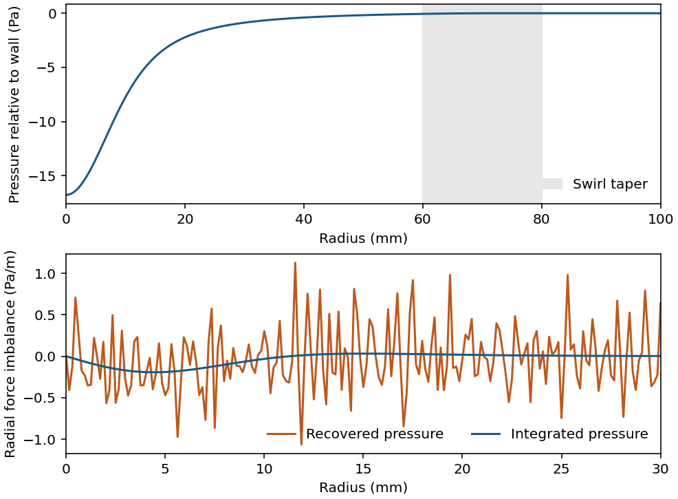

# A balanced initial pressure for a 10 mm water vortex

**At time zero, pressure rises 15.90564 Pa from the axis to 30 mm.** On the finest grid the error against the density-adjusted reference is +0.00032 Pa. Every stored state recovers as liquid water. All three grids meet the pressure and acceleration limits. One refinement check fails. Differentiating the EOS-recovered pressure gives a slightly larger force error on the finest grid than on the middle grid. The evidence supports using the field as initial data. Whether a CFD solver preserves it remains open. [Measurements](vortex_equilibrium.json) · [Finest radial state, CSV](vortex_initial_state.csv)

A parcel circling the axis needs a continuous inward acceleration to turn. Water just outside the parcel must push harder than water just inside it. At the fastest swirl, 0.1 m/s at 10 mm, the required acceleration is 1 m/s². A uniform initial pressure would leave that entire acceleration unbalanced. A smaller pressure error can still launch radial motion and sound that obscure slow viscous spreading.



## Initial state and independent measurements

At 293.15 K we integrated from the 100 mm wall at 101325 Pa absolute inward, with one explicit midpoint step in **radius** per cell. The state and diagnostics live at cell endpoints, including the axis and wall. Each half-step predicts pressure using the outer-node value of ρuθ²/r, then evaluates density from pressure and temperature at the midpoint. The R277 profile peaks at 10 mm, tapers smoothly from 60 to 80 mm, and gives exactly uniform pressure through the stationary outer ring. Near the axis uθ ≈ Ωr with Ω ≈ 17.56 s⁻¹, so uθ²/r ≈ Ω²r and dp/dr vanishes at zero. [Profile and reference](SPREADING_RESULT.md) · [Calculation](../../physics_first/vortex_equilibrium.py)

The HEOS water flash at each node supplies ρ and specific internal energy e. We store (ρ, 0, ρuθ, 0, ρE) in radial, azimuthal and axial order, with E = e + uθ²/2. A fresh EOS object recovers p and T from ρ and e = (ρE)/ρ − |momentum/ρ|²/2. We checked finiteness and single-phase liquid on construction and recovery. On the finest grid the axis is at 101308.22390 Pa and 998.20714278 kg/m³. At the wall the density is 998.20715047 kg/m³. At the peak the kinetic contribution is 0.005 J/kg on top of 83905.79433 J/kg of internal energy. [Conservative and recovered fields](vortex_initial_state.csv) · [CoolProp water EOS](https://coolprop.org/fluid_properties/fluids/Water.html)

| Cells/core | Δr (mm) | Inner rise (Pa) | Error (Pa) | Inner integral defect (m²/s²) | Max EOS Δp (Pa, absolute error) | Max EOS ΔT (K, absolute error) |
|---:|---:|---:|---:|---:|---:|---:|
| 16 | 0.62500 | 15.910450 | +0.005134 | +5.1433×10⁻⁶ | 0.000235 | 3.61×10⁻¹¹ |
| 32 | 0.31250 | 15.906599 | +0.001283 | +1.2850×10⁻⁶ | 0.000201 | 3.25×10⁻¹¹ |
| 64 | 0.15625 | 15.905637 | +0.000321 | +3.2121×10⁻⁷ | 0.000213 | 3.63×10⁻¹¹ |

The saved incompressible 128-mode result is 15.902015666 Pa at 998 kg/m³. Multiplying by ρwall/998 gives **15.905316377 Pa**. This comparison holds density constant at its wall value. The actual axis-to-wall density change is only 7.7×10⁻⁶ kg/m³. Its effect on this benchmark is bounded by about 1.3×10⁻⁷ Pa. Each grid passes the 0.05 Pa pressure-rise limit and the 0.01 Pa EOS pressure-recovery limit. All 161, 321 and 641 nodes passed both phase checks. [R277 evidence](spreading_results.json)

For an independent identity, we integrated the EOS specific volume in **pressure** from the calculated axis pressure to the outer endpoint at fixed T. Separately, adaptive Gauss–Kronrod quadrature integrated the analytic tapered uθ²/r in **radius**, splitting at the taper boundaries for the full cylinder. Neither side sums the pressure-march increments. At 64 cells/core the respective inner values are 0.015934204672 and 0.015933883467 m²/s². Axis-to-wall defects are +5.026×10⁻⁶, +1.256×10⁻⁶ and +3.138×10⁻⁷ m²/s². The inner rise and both integral defects decrease fourfold per halving of Δr, as expected for midpoint integration.

## Local radial balance and the failed refinement check

We applied a centered Python stencil to the **recovered** pressure, with even symmetry at zero and an actual neighbor beyond 30 mm. The signed force per volume is F = dp/dr − ρuθ²/r in Pa/m. The implied outward radial acceleration is −F/ρ. The table gives the signed value at the largest absolute imbalance. RMS uses the trapezoidal integral of the squared quantity against dr, divided by 0.030 m, then square-rooted. This weights equal radial intervals equally.

| Cells/core | F at max magnitude (Pa/m) | Radius (mm) | RMS F (Pa/m) | Acceleration at peak (m/s²) | RMS acceleration (m/s²) |
|---:|---:|---:|---:|---:|---:|
| 16 | −3.1975 | 5.0000 | 1.2855 | +0.003203 | 0.001288 |
| 32 | −0.9106 | 3.1250 | 0.3554 | +0.000912 | 0.000356 |
| 64 | +1.1276 | 11.5625 | 0.3803 | −0.001130 | 0.000381 |

The finest RMS acceleration is **0.0381%** of the 1 m/s² characteristic acceleration, below the 1% target. But the observed RMS force orders are **1.85 and −0.10**. To locate the cause, we kept the conservative density, momentum, nodes and stencil fixed and used the integrated pressure. Its RMS force errors are **1.2801, 0.3202 and 0.08006 Pa/m**, almost exactly second order. The stencil applied to the round-trip pressure difference alone gives **0.1116, 0.1582 and 0.3710 Pa/m RMS**. This isolates the contribution that dominates the finest grid. Nodal round-trip errors of order 0.0002 Pa are small in pressure units, but differences between neighbors are divided by 2Δr. The combined flash, storage and inversion contribute to this observed precision limit. Their individual shares remain unresolved. For this second-order method the calculation checks observed orders in the range 1.8–2.2. The final recovered-force order also fails the basic requirement that error decrease. [Signed peaks, RMS and observed orders](vortex_equilibrium.json)

**SU2 radial momentum residual remains unmeasured.** The qualified mesh is a straight strip with repeated states across its height. It lacks the curved momentum flux of a rotating cross-section. The installed SU2 8.6.0 meridional axisymmetric operator has two velocity components and no azimuthal momentum equation or swirl source. A suitable test would need a resolved transverse disk with a regular center, tangential wall, Cartesian momenta mapped from the radial state, and access to the assembled flux residual before any update. It would project the two momentum residuals onto the radial direction and normalize by dual volume and density, with a separate symmetry check at the center. The installed executable has no Python wrapper, and the qualified acoustic restart exposes the last Runge–Kutta stage after stepping. Building and validating that geometry and obtaining a time-zero residual is a separate solver task. [Installed-source axisymmetric operator](https://github.com/su2code/SU2/blob/7048fd35f56d4bf52e586429d6746a36a10255f8/SU2_CFD/src/numerics/flow/flow_sources.cpp#L190-L212) · [Acoustic mesh and output](../../physics_first/su2_acoustic.py)

## Cost of evolving the vortex

The present acoustic setting advances 0.131759 μs per step. Five seconds would take **37.95 million steps** even at the acoustic strip's spacing. Applying its acoustic Courant number 0.25 to the vortex gives Δt ≈ 0.25Δr/c, with c = 1482.35 m/s. At 16, 32 and 64 cells/core the estimates are **105.4, 52.7 and 26.35 ns**, or **47.4, 94.9 and 189.7 million steps for 5 s**. These use radial spacing alone. A smaller disk edge or a multidimensional stability limit could shorten the step. [Acoustic benchmark](ACOUSTIC_RESULT.md)

For a wall-clock scale, on daisy the modification times of binary restarts 1 and 512 in the saved 128-cell 10 Pa case span 22.687 s for 511 intervals. The repeat and 100 Pa control span 22.618 and 22.724 s. That is roughly **44 ms per step**, including per-step restart I/O on a 387-vertex strip. At precisely that throughput, the saved step would cost about **19 days** for 5 s and the finest radial step about **97 days**. The disk would have a different vertex count, I/O schedule and per-step cost. A disk wall time remains unmeasured.

A seconds-long calculation calls for a time-accurate treatment of the fast pressure waves, for example an implicit acoustic step or a converged dual-time solve, together with low-Mach spatial fluxes that preserve small dynamic pressures at Mach 6.7×10⁻⁵. It must retain the physical EOS, conservative energy and viscous stresses. Enlarging Δt alone leaves spatial imbalance and excess shear damping. At the finest spacing Δr/U = 1.56 ms and Δr²/ν ≈ 24 ms. A candidate starting step of 0.39 ms gives an advective Courant number of 0.25 and about 12,800 steps over 5 s. Actual accuracy depends on mesh, flux, viscous discretization, and inner iteration tolerances. Fast acoustic transients would still need short physical steps if their waveform were an observable. [General-EOS low-Mach time integration](https://arxiv.org/abs/2402.09252)

Before a multi-second run, a candidate method needs a measured time-zero solver balance, a shear diffusivity measurement, and grid, physical-step and inner-solve refinements showing pressure, peak radius and kinetic-energy loss are resolved against the viscous reference. Inner algebraic error must be small relative to the pressure differences and viscous decay of interest. Measure wall time per accepted step including the pressure solve. No implicit or all-speed implementation was installed or exercised here. [Spreading observables and tolerances](SPREADING_RESULT.md)

## Recommended next experiment

**Measure one transverse shear Fourier mode in a doubly periodic strip.** Use λ = 10 μm along x, height λ/8 with four transverse cells, uᵧ = 0.01 sin(2πx/λ) m/s, uₓ = 0, and uniform initial p, T and density as above. Include the local transverse kinetic energy in ρE. Periodicity in y allows the transverse motion through both sides. Retain the qualified water EOS, viscosity and explicit flux/time scheme. With ν = μ/ρ = 1.0034×10⁻⁶ m²/s, A(t)/A(0) = exp(−νk²t), k = 2π/λ. At eight acoustic crossings (53.97 ns) the predicted amplitude loss is **2.115%**. Shortening λ increases viscous decay per acoustic crossing. This is a small first screen of the solver's shear damping at a specified wavelength and grid spacing.

Use 32 and 64 cells/wavelength at the same Δt = λ/(256c) = 26.35 ps (2048 steps each). Repeat only the fine case at half Δt (4096 steps). Fit log amplitude versus time from the dual-volume-weighted transverse velocity Fourier mode, using the initial state and all four quarter-time endpoints. Report νeff = −slope/k², its excess over μ/ρ, the spread across interval fits, and pressure or longitudinal-velocity leakage. A proposed decision is agreement of the finest νeff with μ/ρ within 10%, with grid, time-step and interval-fit changes each below 5% of μ/ρ. Report the residual uncertainty or excess damping if these fail. The result applies at the tested scale. Transfer to the vortex mesh still requires verification. Stop after these three short shear cases for review.

## Reproduction

Use Python 3.12.14, NumPy 2.5.5, CoolProp 7.2.0 and SciPy 1.17.1. On daisy we used the dedicated acoustic interpreter with the existing R277 SciPy wheel directory on PYTHONPATH. From the repository root, the two commands below regenerate the CSV and JSON in the current directory and run the 14 targeted unit tests. The calculation writes valid measurements and **exits 1** for the failed scientific refinement check. All 14 unit tests passed. The saved JSON and CSV reproduced byte-for-byte. [Solver environment](SU2_WATER_SETUP.md) · [Regression tests](../../tests/test_vortex_equilibrium.py)

```bash
water_python="$HOME/.local/opt/water-acoustics/tools/bin/python"
export PYTHONPATH=/tmp/water-r277-scipy.MZ7N4z
"$water_python" -m physics_first.vortex_equilibrium --csv vortex_initial_state.csv > vortex_equilibrium.json
"$water_python" -m unittest -v tests.test_vortex_equilibrium tests.test_cylinder_spreading tests.test_water_acoustics tests.test_water_scales
MPLBACKEND=Agg python3 -m physics_first.plot_vortex_equilibrium vortex_initial_state.csv vortex_equilibrium.png
```

The plot used system Matplotlib 3.10.7. On another machine, use an interpreter with the listed dependencies and omit the daisy-specific PYTHONPATH. No vortex time update or CFD run took place in R283.
